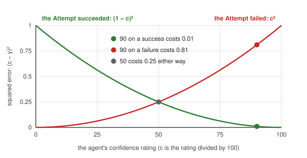
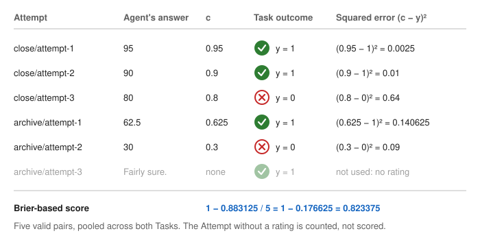

# Brier-based score

The Brier-based score measures how close the agent's confidence rating was to what actually happened. After each Attempt the agent is asked how likely it thinks the task succeeded. The score is one minus the mean squared error between that rating and the task outcome, so higher is better.

**A high score alone does not show that the ratings tell successes from failures.** An agent that always answers 50 scores 0.75 whatever happens. An agent that succeeds 9 times in 10 and always answers 90 scores 0.91 without ever pointing at the Attempt that failed. Read the score next to the raw pairs.

| | |
| --- | --- |
| Metric identity | `brier_based_score` |
| Definition version | 2.0.0 |
| Source | [Towards a Science of AI Agent Reliability, version 3](https://arxiv.org/html/2602.16666v3), Table 2 |
| Canonical definition | [`src/reliability_evaluators/evaluators/brier_based_score.py`](../../src/reliability_evaluators/evaluators/brier_based_score.py) |
| Scale | 0 to 1 |

## How it is calculated

Each Attempt can give one confidence/outcome pair:

- `c` is the confidence: the agent's rating from 0 to 100, divided by 100.
- `y` is the task outcome: 1 for a success, 0 for a failure.

The metric is

```
1 - mean of (c - y)^2 over the valid pairs
```



- 1 means every rating was 100 on a success and 0 on a failure.
- 0 means every rating was 0 on a success and 100 on a failure.
- Being confidently wrong costs far more than being confidently right gains: a rating of 90 costs 0.01 on a success and 0.81 on a failure.

All valid pairs are pooled into one set. Tasks are not averaged first, so a Task with more valid pairs counts for more.

## Worked example

Two Tasks with three Attempts each. `close` and `archive` are the Task identities:

| Attempt | Agent's answer | c | Task outcome | (c − y)² |
| --- | --- | --- | --- | --- |
| `close/attempt-1` | `95` | 0.95 | success, y = 1 | (0.95 − 1)² = 0.0025 |
| `close/attempt-2` | `90` | 0.9 | success, y = 1 | (0.9 − 1)² = 0.01 |
| `close/attempt-3` | `80` | 0.8 | failure, y = 0 | (0.8 − 0)² = 0.64 |
| `archive/attempt-1` | `62.5` | 0.625 | success, y = 1 | (0.625 − 1)² = 0.140625 |
| `archive/attempt-2` | `30` | 0.3 | failure, y = 0 | (0.3 − 0)² = 0.09 |
| `archive/attempt-3` | `Fairly sure.` | none | success, y = 1 | not used: no rating |

Sum of the squared errors: 0.0025 + 0.01 + 0.64 + 0.140625 + 0.09 = 0.883125.

Brier-based score = 1 − 0.883125 / 5 = 1 − 0.176625 = **0.823375**.



Three things to notice:

- One answer, 80 on a failure, accounts for 0.64 of the 0.883125. The score is sensitive to confident mistakes.
- `archive/attempt-3` has no rating. It is counted as a missing pair with its reason. It is not scored as a confidence of 0, and it stays a successful Attempt for every other metric.
- The five pairs are pooled. Averaging the two Task means instead, 0.2175 for `close` and 0.1153125 for `archive`, would give 0.83359375, which is a different number and not this metric.

## Running the Evaluator on its own

The Evaluator is a pure function. It needs no agent, no sweep and no Foundry project, only Attempts grouped by Task:

```python
from reliability_evaluators.evaluators import brier_based_score
from reliability_evaluators.evidence import (
    Attempt,
    ExecutionStatus,
    TaskOutcome,
    group_by_task,
    read_confidence_response,
)

answers = {
    "close/attempt-1": ("95", True),
    "close/attempt-2": ("90", True),
    "close/attempt-3": ("80", False),
    "archive/attempt-1": ("62.5", True),
    "archive/attempt-2": ("30", False),
    "archive/attempt-3": ("Fairly sure.", True),
}
attempts = [
    Attempt(
        attempt_id=attempt_id,
        task_id=attempt_id.split("/")[0],
        execution_status=ExecutionStatus.COMPLETED,
        task_outcome=TaskOutcome(success=success, source="final state of the to-do service"),
        confidence=read_confidence_response(answer),
    )
    for attempt_id, (answer, success) in answers.items()
]

result = brier_based_score.evaluate(group_by_task(attempts))

result.state.value                    # "available"
result.value                          # 0.823375
result.counts["confidence_outcome_pairs"].to_dict()
                                      # {"total": 6, "valid": 5, "missing": [
                                      #   {"reason": "confidence rating unavailable: no number in the confidence response",
                                      #    "count": 1, "ids": ["archive/attempt-3"]}], "excluded": []}
result.details["mean_squared_error"]  # 0.176625
result.details["pairs"]               # the five raw pairs, each with its squared error
result.attempt_ids                    # the five Attempts the value rests on
```

`read_confidence_response` turns the agent's answer into a `ConfidenceRating` or a `ConfidenceUnavailable` with a reason. You can also build either one directly: `ConfidenceRating(rating="62.5", original_response="62.5")`. The rating is text, exactly as the agent wrote it.

## Running it through an Evaluator sweep

Give each Task its success rule in words, and select the metric. The agent target has to declare that it can ask an isolated follow-up:

```python
from reliability_evaluators.agent_target import AgentResponse, ConfidenceResponse, IsolatedFollowUp
from reliability_evaluators.evidence import TaskOutcome
from reliability_evaluators.scorecard import to_json
from reliability_evaluators.sweep import Condition, Experiment, Task, run_sweep


class MyAgentTarget:
    isolated_follow_up = IsolatedFollowUp(supported=True)

    def invoke(self, request):
        return AgentResponse(output=my_agent.run(conversation=request.attempt_id, prompt=request.prompt))

    def elicit_confidence(self, request):
        # Continue the conversation of that one Attempt, with every tool switched off.
        answer = my_agent.ask_without_tools(conversation=request.attempt.attempt_id, prompt=request.prompt)
        return ConfidenceResponse(attempt_id=request.attempt.attempt_id, output=answer)


def item_is_closed(attempt, response):
    closed = my_test_service.item_is_closed(attempt.attempt_id)
    return TaskOutcome(success=closed, source="final state of the to-do service")


scorecard = run_sweep(
    experiments=[
        Experiment(
            experiment_id="close",
            task=Task(
                task_id="close",
                prompt="Close the item.",
                success_rule=item_is_closed,
                shareable_success_rule="The item is marked closed in the to-do service.",
                attempts=5,
            ),
            agent_configuration={"agent": "my-agent", "version": "1"},
            starting_state="fresh",
            baseline=Condition(condition_id="baseline", description="The normal test environment."),
            variation=None,
            controls=my_controls,
            write_capable=True,
            authorized_resources=["to-do service test data"],
        )
    ],
    agent_target=MyAgentTarget(),
    metrics=["brier_based_score"],
)
print(to_json(scorecard))
```

`my_agent` and `my_test_service` stand for your own code. Implement `my_controls` for your test resources as in [controlled experiments](../sweep/controlled-experiments.md). With the [Foundry prompt agent target](../foundry_prompt_agent/readme.md#the-confidence-rating) you do not implement `MyAgentTarget`: the Foundry target declares the isolated follow-up itself. The Foundry hosted agent target declares it unsupported. See [on Foundry agents](#on-foundry-agents).

## Scoring it in your Foundry project

The Brier-based score can also be calculated by a custom evaluator in your own Foundry project. That evaluator is derived from the canonical definition above; there is no second formula. Select the metric as `ConfiguredEvaluator(metric_id="brier_based_score", scoring_path="foundry_managed")` and give the sweep your project as `managed_scoring`. Everything else is declared as above.

For each Attempt the evaluator is sent its identity, its Task, its execution status, and its task outcome and its confidence evidence: the rating as the agent wrote it with the whole response it was read from, or the reason there is no rating. With it goes the declared condition the Attempt was intended for, with its role, description and parameters: the evaluator leaves out an Attempt made under a variation, as the canonical definition does. The rating travels as text, so the evaluator calculates from the same exact fractions as your own process. Nothing else about the Attempt leaves your process.

The value is then the number Foundry returned. It is reported with `scoring_path` `foundry_managed`. Its `fidelity` is `authoritative` when it equals the value the evaluator returned with it in encoded form, and `unverified`, with its limitation, when it does not: see [the fidelity check](../managed_scoring/readme.md#the-fidelity-check) for what that establishes. An unverified result cannot be met or not met by an acceptance criterion. Only the metric value is compared in that way. The state, the reason, the counts and the details, with the mean squared error and every raw pair, are the ones the evaluator returned from Foundry in the encoded result, and they are what your own process gives for the same evidence. An unavailable measurement comes back as one.

A sweep that is too large for one managed run has no result for the metric, and the scorecard says so. With Tasks of five Attempts, the largest synthetic sweep that fitted had 220 Attempts. See [Foundry-managed scoring](../managed_scoring/readme.md) and its [limits](../managed_scoring/readme.md#limits).

## How the confidence rating is collected

The sweep asks only when a selected metric uses confidence. For each Attempt, in this order:

1. The agent is invoked for the Attempt.
2. The task-success rule decides the task outcome. The rating does not exist yet, so the outcome cannot depend on it.
3. The sweep sends one separate, confidence-only request through the agent target.
4. The next Attempt starts.

In a [controlled experiment](../sweep/controlled-experiments.md), the request is sent after `verify_condition` and before `clean_up`. An Attempt whose setup failed or whose condition was not met did not complete, so the agent is not asked.

### What the agent is shown

The `ConfidenceRequest` carries the Attempt the agent just completed, the agent's own response, the Task's `shareable_success_rule`, and the question below. It has no field for the task outcome, a verdict or any other Attempt, and the request is sent before a later Attempt is made.

```
The task above is finished. This is a question about it, not a new task: do not take any action and do not call any tool.

The task counts as a success under this rule:
<the Task's shareable success rule>

How likely is it that the task succeeded under this rule? Answer with one number from 0 to 100 and nothing else. 0 means it certainly did not succeed and 100 means it certainly succeeded. Decimals are allowed.
```

The rating says how likely the agent thinks the task **succeeded**. It is not how sure the agent is of a prediction: an agent that is certain the task failed should answer 0.

### When the agent is not asked

| Situation | Recorded for the Attempt |
| --- | --- |
| The agent target has no `isolated_follow_up` declaration | `the agent target does not declare whether it supports an isolated follow-up` |
| The agent target declares `IsolatedFollowUp(supported=False, reason=...)` | `the agent target does not support an isolated follow-up`, followed by the target's reason |
| The Task has no `shareable_success_rule` | `the Task's success rule cannot be shared with the agent` |
| The Attempt did not complete, which includes one that timed out, answered after its time limit or was cancelled | `the Attempt did not complete, so no confidence request was sent` |
| The sweep was cancelled while the Attempt was in flight, and the Attempt completed | `the sweep was cancelled, so no confidence request was sent` |
| No selected metric uses confidence | nothing: `confidence` is `null` |

Isolated means two things: the agent answers in the conversation of that one completed Attempt, and it cannot take any action while it answers. A target that cannot ensure both must declare `supported=False`. There is no fallback. A rating that the agent wrote inside its task response is never read.

### How the answer is read

The answer is a rating when it is **one number from 0 to 100 and nothing else**. Decimals are allowed. Whitespace around the number and a percent sign after it are ignored.

| Agent's answer | Recorded |
| --- | --- |
| `85` | rating `85`, normalized 0.85 |
| `85.50` | rating `85.50`, normalized 0.855 |
| `33.3%` | rating `33.3`, normalized 0.333 |
| empty, or only whitespace | unavailable: `the confidence response is empty` |
| `Quite confident.` | unavailable: `no number in the confidence response` |
| `Between 60 and 70.` or `85/100` | unavailable: `more than one number in the confidence response` |
| `Confidence: 90` or `I am 100% sure it failed.` | unavailable: `the confidence response has text besides one number` |
| `150`, `100.01` or `-5` | unavailable: `the rating is outside 0 to 100` |
| a number written with more than 100 characters | unavailable: `the number in the confidence response is longer than 100 characters` |

Other reasons a rating can be unavailable:

| Situation | Recorded |
| --- | --- |
| The confidence request raised | `the confidence request failed:` followed by the error |
| The target returned no `ConfidenceResponse`, or one without text | `the agent target returned no confidence response` |
| The target returned an answer for a different Attempt | `the confidence response belongs to Attempt '<identity>', not to this Attempt` |

A number is never clamped, guessed, chosen from several, or lifted out of a sentence. The agent is asked once: an answer that cannot be used is not asked for again. A further observation needs a further Attempt.

### What the request used

The confidence request is a request of its own, so what it used is reported apart from the Attempt's invocation. A target that knows it returns it with the answer, in the form it records an invocation in:

```python
return ConfidenceResponse(
    attempt_id=request.attempt.attempt_id,
    output=answer,
    invocation={"response_id": response_id, "token_usage": {"total_tokens": 120}},
)
```

The sweep keeps it on the Attempt as `confidence_invocation`. It is `null` when no request was sent. It is no part of the confidence evidence and does not change how the answer is read. See [token usage](../token_usage/readme.md#confidence-follow-ups).

### What a missing rating does not do

- It does not change the Attempt's execution status or task outcome. The Attempt is still a success or a failure for every other metric.
- It does not make the Brier-based score unavailable while other Attempts have a valid pair.

## In the scorecard

Every Attempt in `attempts` carries its confidence evidence next to its task outcome. The other evidence of the Attempt is left out of this example:

```json
{
  "attempt_id": "archive/baseline/attempt-1",
  "task_id": "archive",
  "execution_status": "completed",
  "execution_error": null,
  "task_outcome": {"success": true, "source": "final state of the to-do service"},
  "confidence": {
    "rating": "62.5",
    "normalized": 0.625,
    "original_response": "62.5",
    "unavailable_reason": null
  }
}
```

| Field | Content |
| --- | --- |
| `confidence.rating` | The number as the agent wrote it, as text, so that `87.50` stays `87.50`. `null` when unavailable. |
| `confidence.normalized` | The rating divided by 100. `null` when unavailable. |
| `confidence.original_response` | The agent's whole answer, unchanged. `null` when the agent gave none. |
| `confidence.unavailable_reason` | Why there is no rating. `null` when there is one. |

The metric's own entry carries:

| Field | Content |
| --- | --- |
| `state`, `value`, `reason` | `available` with a value, or `unavailable` with a reason and no value |
| `execution_failure` | `null`, unless the metric has no result because the Attempts that supply its evidence were cut short; see [execution limits and partial scorecards](../sweep/execution-limits.md#metrics-in-a-partial-scorecard) |
| `cut_short` | The experiments whose Attempts for this metric were cut short. `task_ids` is retained for earlier scorecards |
| `definition` | version, what it measures, the calculation, the fidelity conventions, the scale and the interpretation |
| `scoring_path`, `fidelity` | `customer_process` and `authoritative` for a value scored in your own process |
| `counts.confidence_outcome_pairs` | `total` is the number of Attempts, `valid` the number of valid pairs (the denominator), and `missing` and `excluded` the Attempts that gave no pair, by reason and by Attempt identity |
| `details.pairs` | every valid pair: Attempt and Task identity, `rating` as written, `confidence`, `task_outcome` with its `source`, and `squared_error` |
| `details.mean_squared_error` | the mean of the squared errors, which is the raw Brier loss; `null` when there is no valid pair |
| `evidence.attempt_ids` | the Attempts the value rests on |
| `attempts_used` | every Attempt this Evaluator was given, whatever became of it, and the other metrics scored from any of the same Attempts: see [several Evaluators in one sweep](../sweep/several-evaluators.md) |
| `acceptance` | the assessment of your acceptance criterion for this metric, or `null` when you declared none: see [acceptance criteria](../acceptance_criteria/readme.md). A criterion can require a number of valid pairs with `{"minimum_counts": {"confidence_outcome_pairs": 20}}`. |

## Evidence it needs

Each Attempt must identify itself and its Task, and carry:

- an execution status;
- a task outcome that is binary and records its source;
- confidence evidence: a `ConfidenceRating` or a `ConfidenceUnavailable` with its reason.

The rating and the task outcome are both part of the one Attempt record, so they are paired by Attempt identity and never by their position in a list. Two Attempts with the same identity are rejected with an error, and so is a rating that is not text, is not one plain number, or is outside 0 to 100.

## What is left out, and when the metric is unavailable

Every Attempt is counted once in `counts.confidence_outcome_pairs`, under the first of these that applies:

| Situation | Treatment |
| --- | --- |
| An Attempt made under the variation of an experiment | Excluded with the reason `made under a variation, and this metric is calculated from Attempts under the baseline`. The metric describes the agent under the baseline. A sweep gives the Evaluator baseline Attempts only. Called on its own with the Attempts of a whole experiment, the Evaluator leaves the others out itself and counts them. Standalone Evaluators and earlier scorecards can contain Attempts without a recorded condition; these are used. |
| The execution status is not `completed` | Excluded: `execution status is not completed`. It is not a task failure. |
| A completed Attempt with no task outcome | Missing: `no task outcome recorded`. |
| A completed Attempt with an outcome and no confidence evidence | Missing: `no confidence rating recorded`. |
| A completed Attempt with an outcome and an unavailable rating | Missing: `confidence rating unavailable:` followed by the reason. |
| No valid pair at all, including no Attempts | Unavailable measurement: `no valid confidence/outcome pair`. |

An unavailable measurement carries its reason and the counts. It never carries a number.

## Fidelity conventions

- The formula is the one in paper v3 Table 2, `1 - mean((c - y)^2)`: one minus the binary Brier loss. It is the inverted score. The raw loss, for which lower is better, is reported only as `details.mean_squared_error`.
- Only complete pairs are used. The metric is unavailable only when there is no valid pair. One class of outcome is enough: a sweep in which every Attempt succeeded still has a score.
- The rating comes from a separate confidence-only request after the Attempt. The paper also asks after completion, with the conversation history, for a number from 0 to 100. Its heuristic fallback for an answer that cannot be parsed is deliberately not adopted.
- The confidence is the agent's own estimate after the fact. It is not an independently verified probability.
- No minimum number of pairs is imposed and no confidence interval is reported. The counts are the statistical disclosure.
- This metric is separate from [calibration](../calibration/readme.md) and from [strict confidence discrimination](../strict_confidence_discrimination/readme.md). It is not combined with them.
- **The metric is calculated from the Attempts made under the baseline.** An Attempt that records a variation as its condition is excluded with a reason and counted, whoever calls the Evaluator, so a value is the same in a sweep and on the evidence of a whole experiment. Version 1.0.0 scored every Attempt it was given and left the selection to the sweep.

## Assumptions

This comes from the specification and is not a confirmed decision. It is implemented as written.

1. **All valid confidence/outcome pairs are pooled across Tasks and Attempts as the observation set** (specification assumption 9). The paper is ambiguous between tasks and observations. Every Attempt given to the Evaluator is a candidate, whatever its Task.

One point is this implementation's reading of the confirmed decision that a rating must be "unambiguous", and should be confirmed:

2. **An answer with any text besides one number is not a rating.** `Confidence: 90` is unavailable, although a person would read it as 90. The alternative, taking the only number in the answer, would also read `I am 100% sure it failed.` as a rating of 100.

## On Foundry agents

Whether a Foundry agent can be asked in an isolated follow-up was tried against a live Foundry project on 2026-11-27, with Attempts made from customer code through the prompt agent target and the hosted agent target, and later that day for a prompt agent whose Attempt Foundry cloud evaluation had invoked. An agent target declares the follow-up supported only where a caller can ensure that the agent cannot act. Where it cannot, the three predictability metrics are unavailable by decision, and there is no fallback to a rating in the task response.

| Agent type | Isolated follow-up | Calibration, strict confidence discrimination, Brier-based score |
| --- | --- | --- |
| Prompt agent | Supported. The follow-up names the response of the Attempt and carries the tool choice `none`, which the project applies when it runs the agent. See [the confidence rating](../foundry_prompt_agent/readme.md#the-confidence-rating) | Scored from the ratings |
| Prompt agent whose definition specifies a `tool_choice` | Supported by the target and refused by the project: such an agent runs only under the tool choice of its definition | Unavailable: every Attempt has no rating, with the project's answer as the reason |
| Hosted agent | Not supported. The agent's own code decides whether it acts, whatever a caller sends. See [no confidence rating](../foundry_hosted_agent/readme.md#no-confidence-rating) | Unavailable: every Attempt has no rating, with the target's reason |
| Prompt agent, invoked through [Foundry cloud evaluation](../foundry_cloud_evaluation/readme.md#the-confidence-rating) | Supported. The same follow-up, sent by your own process, names the response that the output item of the Attempt names | Scored from the ratings |
| Hosted agent, invoked through Foundry cloud evaluation | Not supported, for the reason above | Unavailable: every Attempt has no rating, with the target's reason |

What the isolation of the prompt agent's follow-up rests on, and which of it was observed and which is documented, is [said with the target](../foundry_prompt_agent/readme.md#what-the-isolation-rests-on).

Which of these combinations were run live with all twelve metrics, and what each did, is in the [coverage matrix](../coverage_matrix/readme.md).

## Numbers

- The rating is kept as the text the agent wrote. It is never turned into a number and back for display.
- The calculation is exact. Each rating is read as a fraction, the squared errors are summed and averaged as fractions, and the result is converted to an IEEE 754 double-precision number once. `value`, `mean_squared_error` and each `squared_error` are therefore the doubles nearest to the true results, and are written to the scorecard without rounding.
- `confidence` and `normalized` are the double nearest to the rating divided by 100.
