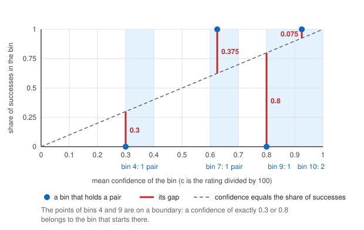
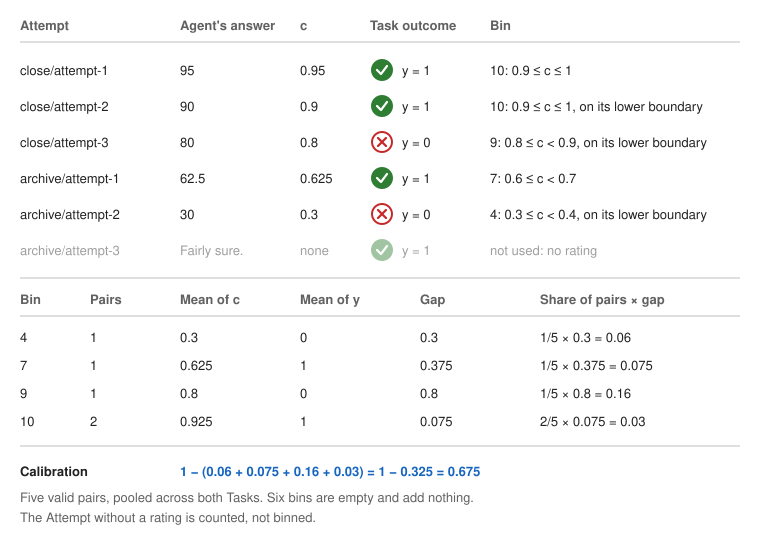

# Calibration

Calibration measures whether the agent's stated confidence matches how often it succeeds. After each Attempt the agent is asked how likely it thinks the task succeeded. Among the Attempts it rated near 70, about 70 in 100 should have succeeded. The metric is one minus the expected calibration error over ten fixed bins of confidence, so higher is better.

**A high value alone does not show that the ratings tell successes from failures.** An agent that succeeds 6 times in 10 and always answers 60 scores 1 without ever pointing at an Attempt that failed. Read the value next to the count of each bin and the raw pairs.

| | |
| --- | --- |
| Metric identity | `calibration` |
| Definition version | 1.0.0 |
| Source | [Towards a Science of AI Agent Reliability, version 3](https://arxiv.org/html/2602.16666v3), Table 2 |
| Canonical definition | [`src/reliability_evaluators/evaluators/calibration.py`](../../src/reliability_evaluators/evaluators/calibration.py) |
| Scale | 0 to 1 |

Calibration is one of three predictability metrics that are calculated from the same confidence/outcome pairs and reported as three separate results. The other two are [strict confidence discrimination](../strict_confidence_discrimination/readme.md) and the [Brier-based score](../brier_based_score/readme.md). They are not combined.

## How it is calculated

Each Attempt can give one confidence/outcome pair:

- `c` is the confidence: the agent's rating from 0 to 100, divided by 100.
- `y` is the task outcome: 1 for a success, 0 for a failure.

The pairs are sorted into ten bins of equal width by `c`:

| Bin | Holds a confidence `c` with | As a rating |
| --- | --- | --- |
| 1 | 0 ≤ c < 0.1 | 0 up to, not including, 10 |
| 2 | 0.1 ≤ c < 0.2 | 10 up to, not including, 20 |
| 3 | 0.2 ≤ c < 0.3 | 20 up to, not including, 30 |
| 4 | 0.3 ≤ c < 0.4 | 30 up to, not including, 40 |
| 5 | 0.4 ≤ c < 0.5 | 40 up to, not including, 50 |
| 6 | 0.5 ≤ c < 0.6 | 50 up to, not including, 60 |
| 7 | 0.6 ≤ c < 0.7 | 60 up to, not including, 70 |
| 8 | 0.7 ≤ c < 0.8 | 70 up to, not including, 80 |
| 9 | 0.8 ≤ c < 0.9 | 80 up to, not including, 90 |
| 10 | 0.9 ≤ c ≤ 1 | 90 up to and including 100 |

A bin is closed below and open above, and the last bin also includes 1. A confidence exactly on a boundary belongs to the bin that starts there: a rating of 10 is in bin 2 and a rating of 90 is in bin 10.

For each bin that holds at least one pair:

```
gap = | mean of y in the bin - mean of c in the bin |
```

The expected calibration error is the sum of the gaps, each weighted by the bin's share of all pairs. The metric is one minus that:

```
1 - sum over the bins that hold a pair of (pairs in the bin / all pairs) * gap
```



- 1 means that in every bin that holds a pair, the mean confidence equals the share of successes.
- 0 means every rating was 0 on a success and 100 on a failure.
- A bin without a pair contributes nothing.
- The gap is taken between the two means of a bin. It is not the mean of `|c - y|` over the pairs, so errors in opposite directions inside one bin cancel: a success and a failure that were both rated 50 give a gap of 0.

All valid pairs are pooled into one set before they are binned. Tasks are not averaged first, so a Task with more valid pairs counts for more.

## Worked example

Two Tasks with three Attempts each. `close` and `archive` are the Task identities. These are the same six Attempts as in the worked example of the [Brier-based score](../brier_based_score/readme.md#worked-example):

| Attempt | Agent's answer | c | Task outcome | Bin |
| --- | --- | --- | --- | --- |
| `close/attempt-1` | `95` | 0.95 | success, y = 1 | 10: 0.9 ≤ c ≤ 1 |
| `close/attempt-2` | `90` | 0.9 | success, y = 1 | 10: 0.9 ≤ c ≤ 1 |
| `close/attempt-3` | `80` | 0.8 | failure, y = 0 | 9: 0.8 ≤ c < 0.9 |
| `archive/attempt-1` | `62.5` | 0.625 | success, y = 1 | 7: 0.6 ≤ c < 0.7 |
| `archive/attempt-2` | `30` | 0.3 | failure, y = 0 | 4: 0.3 ≤ c < 0.4 |
| `archive/attempt-3` | `Fairly sure.` | none | success, y = 1 | not used: no rating |

Five valid pairs fall into four bins. The other six bins are empty:

| Bin | Pairs | Mean of c | Mean of y | Gap | Share of pairs × gap |
| --- | --- | --- | --- | --- | --- |
| 4 | 1 | 0.3 | 0 / 1 = 0 | 0.3 | 1/5 × 0.3 = 0.06 |
| 7 | 1 | 0.625 | 1 / 1 = 1 | 0.375 | 1/5 × 0.375 = 0.075 |
| 9 | 1 | 0.8 | 0 / 1 = 0 | 0.8 | 1/5 × 0.8 = 0.16 |
| 10 | 2 | (0.95 + 0.9) / 2 = 0.925 | 2 / 2 = 1 | 0.075 | 2/5 × 0.075 = 0.03 |

Expected calibration error: 0.06 + 0.075 + 0.16 + 0.03 = 0.325.

Calibration = 1 − 0.325 = **0.675**.



Four things to notice:

- Three ratings are exactly on a boundary: 90, 80 and 30. Each belongs to the bin that starts there, so 90 shares bin 10 with 95 and not bin 9 with 80. The boundary convention is an [assumption](#assumptions).
- Bin 10 holds two of the five pairs, so its gap counts twice as much as each of the others.
- `archive/attempt-3` has no rating. It is counted as a missing pair with its reason. It is not put in the first bin as a confidence of 0, and it stays a successful Attempt for every other metric.
- The five pairs are pooled. Calculating each Task on its own, 41/60 for `close` and 53/80 for `archive`, and averaging the two would give about 0.6729, which is a different number and not this metric.

## Running the Evaluator on its own

The Evaluator is a pure function. It needs no agent, no sweep and no Foundry project, only Attempts grouped by Task:

```python
from reliability_evaluators.evaluators import calibration
from reliability_evaluators.evidence import (
    Attempt,
    ExecutionStatus,
    TaskOutcome,
    group_by_task,
    read_confidence_response,
)

answers = {
    "close/attempt-1": ("95", True),
    "close/attempt-2": ("90", True),
    "close/attempt-3": ("80", False),
    "archive/attempt-1": ("62.5", True),
    "archive/attempt-2": ("30", False),
    "archive/attempt-3": ("Fairly sure.", True),
}
attempts = [
    Attempt(
        attempt_id=attempt_id,
        task_id=attempt_id.split("/")[0],
        execution_status=ExecutionStatus.COMPLETED,
        task_outcome=TaskOutcome(success=success, source="final state of the to-do service"),
        confidence=read_confidence_response(answer),
    )
    for attempt_id, (answer, success) in answers.items()
]

result = calibration.evaluate(group_by_task(attempts))

result.state.value                            # "available"
result.value                                  # 0.675
result.counts["confidence_outcome_pairs"].to_dict()
                                              # {"total": 6, "valid": 5, "missing": [
                                              #   {"reason": "confidence rating unavailable: no number in the confidence response",
                                              #    "count": 1, "ids": ["archive/attempt-3"]}], "excluded": []}
result.details["expected_calibration_error"]  # 0.325
result.details["bins"][9]                     # {"bin": 10, "lower_bound": 0.9, "upper_bound": 1.0,
                                              #  "includes_upper_bound": True, "count": 2, "successes": 2,
                                              #  "mean_confidence": 0.925, "success_frequency": 1.0,
                                              #  "gap": 0.075, "contribution": 0.03}
result.details["pairs"][1]["bin"]             # 10: the rating 90 is on the lower boundary of bin 10
result.attempt_ids                            # the five Attempts the value rests on
```

`read_confidence_response` turns the agent's answer into a `ConfidenceRating` or a `ConfidenceUnavailable` with a reason. The rating is text, exactly as the agent wrote it.

## Running it through an Evaluator sweep

Select the metric by its identity. Each Task needs a `shareable_success_rule`, and the agent target has to declare that it can ask an isolated follow-up. Both are described, with a complete example, in the [Brier-based score documentation](../brier_based_score/readme.md#running-it-through-an-evaluator-sweep):

```python
scorecard = run_sweep(
    tasks=tasks,
    agent_target=MyAgentTarget(),
    metrics=["calibration", "strict_confidence_discrimination", "brier_based_score"],
)
```

The agent is asked for its confidence once per Attempt, however many of the three metrics are selected. Each selected metric is a separate entry in the scorecard with its own value, state, counts and details. Selecting `calibration` alone is enough to have the agent asked.

How the rating is collected, what the agent is shown, how its answer is read and when a rating is unavailable is the same for all three metrics: see [how the confidence rating is collected](../brier_based_score/readme.md#how-the-confidence-rating-is-collected).

## In the scorecard

The metric's own entry carries:

| Field | Content |
| --- | --- |
| `state`, `value`, `reason` | `available` with a value, or `unavailable` with a reason and no value |
| `execution_failure` | `null`, unless the metric has no result because the Attempts that supply its evidence were cut short; see [execution limits and partial scorecards](../sweep/execution-limits.md#metrics-in-a-partial-scorecard) |
| `cut_short` | The experiments, and the Tasks given without one, whose Attempts for this metric were cut short. Both lists are empty when none were |
| `definition` | version, what it measures, the calculation, the fidelity conventions, the scale and the interpretation |
| `scoring_path`, `fidelity` | `customer_process` and `authoritative` for a value scored in your own process |
| `counts.confidence_outcome_pairs` | `total` is the number of Attempts, `valid` the number of valid pairs (the denominator), and `missing` and `excluded` the Attempts that gave no pair, by reason and by Attempt identity |
| `details.expected_calibration_error` | the weighted sum of the gaps, which is one minus the value; `null` when there is no valid pair |
| `details.bins` | all ten bins, in order, including the empty ones |
| `details.pairs` | every valid pair: Attempt and Task identity, `rating` as written, `confidence`, `task_outcome` with its `source`, and the number of the `bin` it is in |
| `evidence.attempt_ids` | the Attempts the value rests on |
| `attempts_used` | every Attempt this Evaluator was given, whatever became of it, and the other metrics scored from any of the same Attempts: see [several Evaluators in one sweep](../sweep/several-evaluators.md) |
| `acceptance` | the assessment of your acceptance criterion for this metric, or `null` when you declared none: see [acceptance criteria](../acceptance_criteria/readme.md). A criterion can require a number of valid pairs with `{"minimum_counts": {"confidence_outcome_pairs": 20}}`. |

Each entry of `details.bins`:

| Field | Content |
| --- | --- |
| `bin` | the number of the bin, 1 to 10 |
| `lower_bound`, `upper_bound` | the boundaries of the bin on the scale 0 to 1. The lower boundary belongs to the bin. |
| `includes_upper_bound` | whether the upper boundary belongs to the bin: `true` for bin 10 only |
| `count` | the number of valid pairs in the bin |
| `successes` | how many of them are successes |
| `mean_confidence` | the mean of `c` over the pairs in the bin; `null` for an empty bin |
| `success_frequency` | `successes / count`; `null` for an empty bin |
| `gap` | the absolute difference between the two; `null` for an empty bin |
| `contribution` | `count / valid pairs × gap`, what the bin adds to the expected calibration error; `null` for an empty bin |

The bins are a summary next to the raw pairs, never instead of them. A pair keeps its rating as the agent wrote it, and the means of a bin are taken over the unrounded confidences of its pairs, not over the middle of the bin.

## Evidence it needs

The same as the Brier-based score. Each Attempt must identify itself and its Task, and carry:

- an execution status;
- a task outcome that is binary and records its source;
- confidence evidence: a `ConfidenceRating` or a `ConfidenceUnavailable` with its reason.

The rating and the task outcome are both part of the one Attempt record, so they are paired by Attempt identity and never by their position in a list.

## What is left out, and when the metric is unavailable

Every Attempt is counted once in `counts.confidence_outcome_pairs`, under the first of these that applies:

| Situation | Treatment |
| --- | --- |
| The execution status is not `completed` | Excluded: `execution status is not completed`. It is not a task failure. |
| A completed Attempt with no task outcome | Missing: `no task outcome recorded`. |
| A completed Attempt with an outcome and no confidence evidence | Missing: `no confidence rating recorded`. |
| A completed Attempt with an outcome and an unavailable rating | Missing: `confidence rating unavailable:` followed by the reason. |
| No valid pair at all, including no Attempts | Unavailable measurement: `no valid confidence/outcome pair`. |

An unavailable measurement carries its reason, the counts and the ten empty bins. It never carries a number.

One class of outcome is enough: a sweep in which every Attempt succeeded still has a calibration value.

## Fidelity conventions

- The formula is the one in paper v3 Table 2: one minus the expected calibration error, `1 - sum_b (n_b / N) * |mean(y in b) - mean(c in b)|`.
- Table 2 fixes neither the number of bins nor their boundaries. Ten fixed bins of equal width are used. That is a confirmed decision; which bin a boundary belongs to is an [assumption](#assumptions).
- The gap is between the two means of a bin. Averaging `|c - y|` over the pairs is a different quantity and is not binned calibration.
- Binning never rounds or replaces an observation. Every raw pair is reported with the rating as written, next to the boundaries and the count of every bin.
- Only complete pairs are used. The metric is unavailable only when there is no valid pair.
- The rating comes from a separate confidence-only request after the Attempt. The paper's heuristic fallback for an answer that cannot be parsed is deliberately not adopted.
- The confidence is the agent's own estimate after the fact. It is not an independently verified probability.
- No minimum number of pairs is imposed and no confidence interval is reported. The counts are the statistical disclosure. A bin with one or two pairs says little about how often the agent succeeds at that confidence.
- This metric is separate from strict confidence discrimination and from the Brier-based score. It is not combined with them.

## Assumptions

These come from the specification and are not confirmed decisions. They are implemented as written.

1. **A bin is closed below and open above, and the last bin also includes 1. A bin without a pair contributes nothing** (specification assumption 12). The paper does not say which bin a confidence on a boundary belongs to. Agents often answer in round numbers such as 70, 80 and 90, which are all on a boundary, so the choice can change the value. A success rated 90 and a failure rated 85 are in bins 10 and 9 here, with gaps of 0.1 and 0.85 and a value of 0.525. With bins that are open below and closed above, the two would share a bin with a gap of 0.375 and a value of 0.625.
2. **All valid confidence/outcome pairs are pooled across Tasks and Attempts as the observation set** (specification assumption 9). The paper is ambiguous between tasks and observations. Every Attempt given to the Evaluator is a candidate, whatever its Task.

## What is not verified

Calibration is calculated from the same confidence ratings as the Brier-based score, so the same limits apply: see [on Foundry agents](../brier_based_score/readme.md#on-foundry-agents) there. Where a rating cannot be collected in an isolated follow-up, as for a Foundry hosted agent, the three predictability metrics are unavailable by decision. With Foundry cloud evaluation as the entry point the follow-up is not verified.

## Numbers

- The rating is kept as the text the agent wrote. It is never turned into a number and back for display.
- The calculation is exact. Each rating is read as a fraction, the bin is decided from that fraction, and the means, gaps and their weighted sum are calculated as fractions. Each reported number is converted to an IEEE 754 double-precision number once, so `value`, `expected_calibration_error`, `mean_confidence`, `success_frequency`, `gap` and `contribution` are the doubles nearest to the true results, and are written to the scorecard without rounding.
- `lower_bound` and `upper_bound` are the doubles nearest to 0, 0.1, 0.2 and so on to 1. The bin itself is decided against the exact tenths.
- `confidence` is the double nearest to the rating divided by 100. For a rating with very many digits it can differ from the exact confidence that decided the bin: the rating `29.999999999999999999` is below 30 and is in bin 3, while its `confidence` is written as 0.3. The `rating` shows what the agent wrote.
