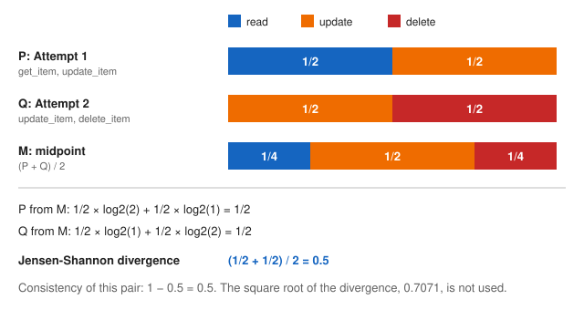
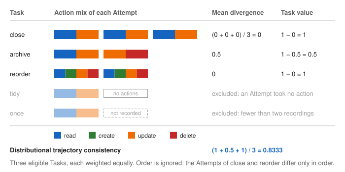

# Distributional trajectory consistency

Distributional trajectory consistency measures whether repeated Attempts at the same Task use the same mix of action types.

**A high value shows neither correctness nor compliance.** An agent that calls the same wrong or forbidden tools in the same proportions on every Attempt scores 1. The metric also ignores the order of the actions; that is what [sequential trajectory consistency](../sequential_trajectory_consistency/readme.md) measures. A low value is not a failure either: different mixes of actions can be equally valid.

| | |
| --- | --- |
| Metric identity | `distributional_trajectory_consistency` |
| Definition version | 2.0.0 |
| Source | [Towards a Science of AI Agent Reliability, version 3](https://arxiv.org/html/2602.16666v3), Table 2 |
| Canonical definition | [`src/reliability_evaluators/evaluators/distributional_trajectory_consistency.py`](../../src/reliability_evaluators/evaluators/distributional_trajectory_consistency.py) |
| Scale | 0 to 1 |

## What you declare

Two things, and neither has a default:

- **The evidence source**: where the actions of an Attempt are recorded from, for example the agent's native tool calls or the effects observed on the service side. The two can differ for the same Attempts, and then the metric differs too. In a prototype run, the same five Attempts gave 1 from service-side effects and 0.997 from native tool calls. This offering does not choose for you.
- **The action-type mapping**: the action type of each tool name. Tool names with the same action type are the same action.

Both are written into the scorecard next to the value.

## How it is calculated

1. The actions of each Attempt are mapped to action types and counted. The share of the Attempt's actions that each action type takes is its action-type frequency distribution.
2. For every pair of Attempts at a Task, the base-2 Jensen-Shannon divergence between their two distributions `P` and `Q` is calculated. With `M = (P + Q) / 2`:

   ```
   JSD(P, Q) = 1/2 × Σ P_i × log2(P_i / M_i)  +  1/2 × Σ Q_i × log2(Q_i / M_i)
   ```

   An action type with frequency 0 contributes nothing to its sum. The divergence is 0 for identical mixes and 1 for mixes with no action type in common.
3. The Task value is one minus the mean divergence over all pairs of its Attempts.
4. The metric is the mean of the Task values, with every eligible Task weighted equally.



The pair in the picture, worked out:

| Action type | P (Attempt 1) | Q (Attempt 2) | M | P × log2(P / M) | Q × log2(Q / M) |
| --- | --- | --- | --- | --- | --- |
| read | 1/2 | 0 | 1/4 | 1/2 × log2(2) = 1/2 | 0 |
| update | 1/2 | 1/2 | 1/2 | 1/2 × log2(1) = 0 | 1/2 × log2(1) = 0 |
| delete | 0 | 1/2 | 1/4 | 0 | 1/2 × log2(2) = 1/2 |
| Sum | | | | 1/2 | 1/2 |

`JSD = 1/2 × 1/2 + 1/2 × 1/2 = 0.5`, so this pair has a consistency of `1 − 0.5 = 0.5`.

## Worked example

Five Tasks. The declared mapping is `get_item` and `list_items` → `read`, `create_item` → `create`, `update_item` → `update`, `delete_item` → `delete`.

| Task | Attempt | Recorded tool calls | Action-type mix |
| --- | --- | --- | --- |
| `close` | 1 | `get_item`, `update_item` | read 1/2, update 1/2 |
| | 2 | `list_items`, `update_item` | read 1/2, update 1/2 |
| | 3 | `update_item`, `get_item` | read 1/2, update 1/2 |
| `archive` | 1 | `get_item`, `update_item` | read 1/2, update 1/2 |
| | 2 | `update_item`, `delete_item` | update 1/2, delete 1/2 |
| `reorder` | 1 | `get_item`, `create_item`, `update_item`, `delete_item` | read, create, update, delete 1/4 each |
| | 2 | `get_item`, `update_item`, `delete_item`, `create_item` | read, create, update, delete 1/4 each |
| `tidy` | 1 | `get_item`, `update_item` | read 1/2, update 1/2 |
| | 2 | recorded, no tool calls | none: a confirmed empty sequence |
| `once` | 1 | `get_item`, `update_item` | read 1/2, update 1/2 |
| | 2 | not recorded | unknown |

| Task | Pairs | Divergence of each pair | Mean | Task value |
| --- | --- | --- | --- | --- |
| `close` | 3 | 0, 0, 0 | 0 | 1 − 0 = 1 |
| `archive` | 1 | 0.5 (worked out above) | 0.5 | 1 − 0.5 = 0.5 |
| `reorder` | 1 | 0 | 0 | 1 − 0 = 1 |
| `tidy` | not used | | | excluded: an Attempt with a confirmed empty action sequence |
| `once` | not used | | | excluded: fewer than two Attempts with a usable action recording |

Distributional trajectory consistency = (1 + 0.5 + 1) / 3 = **0.8333** (0.8333333333333334 as computed), over 5 pairs of Attempts in 3 eligible Tasks.



Things to notice:

- `close` scores 1 although its third Attempt took the actions in the opposite order, and `reorder` scores 1 although its Attempts order four actions differently. Order is not measured here. The same Attempts give a sequential trajectory consistency of 0.2083.
- `get_item` and `list_items` count as the same action because the mapping declares both as `read`.
- `tidy` is excluded as a Task. Its second Attempt is known to have taken no action, so it has no action-type distribution. The Attempt is not dropped, which would make the Task look perfectly consistent, and no "no action" category is invented.
- `once` is excluded for a different reason: its second Attempt has no recording at all. A missing recording is not a confirmed empty sequence.
- Tasks are weighted equally whatever their number of pairs. Pooling the five pairs would give 1 − 0.5 / 5 = 0.9, which is a different number and not this metric.

## Running the Evaluator on its own

The Evaluator is a pure function. It needs no agent, no sweep and no Foundry project, only Attempts grouped by Task and your declaration:

```python
from reliability_evaluators.evaluators import distributional_trajectory_consistency
from reliability_evaluators.evidence import (
    ActionEvent,
    ActionEvidence,
    ActionTypeMapping,
    Attempt,
    ExecutionStatus,
    group_by_task,
)

SOURCE = "native tool calls"
NOT_RECORDED = None
tool_calls = {
    "close": [["get_item", "update_item"], ["list_items", "update_item"], ["update_item", "get_item"]],
    "archive": [["get_item", "update_item"], ["update_item", "delete_item"]],
    "reorder": [
        ["get_item", "create_item", "update_item", "delete_item"],
        ["get_item", "update_item", "delete_item", "create_item"],
    ],
    "tidy": [["get_item", "update_item"], []],
    "once": [["get_item", "update_item"], NOT_RECORDED],
}
attempts = [
    Attempt(
        attempt_id=f"{task_id}/attempt-{number}",
        task_id=task_id,
        execution_status=ExecutionStatus.COMPLETED,
        action_evidence=None
        if tool_names is NOT_RECORDED
        else ActionEvidence(source=SOURCE, events=[ActionEvent(tool_name=name) for name in tool_names]),
    )
    for task_id, recordings in tool_calls.items()
    for number, tool_names in enumerate(recordings, start=1)
]
action_types = ActionTypeMapping(
    evidence_source=SOURCE,
    action_types={
        "get_item": "read",
        "list_items": "read",
        "create_item": "create",
        "update_item": "update",
        "delete_item": "delete",
    },
)

result = distributional_trajectory_consistency.evaluate(group_by_task(attempts), action_types)

result.state.value                        # "available"
result.value                              # 0.8333333333333334
result.counts["attempt_pairs"].valid      # 5
result.counts["tasks"].to_dict()          # total 5, valid 3, and the two excluded Tasks with their reasons
result.details["per_task"]                # Attempts, pairs, mean divergence and value of each eligible Task
result.details["evidence_source"]         # "native tool calls"
result.details["action_type_mapping"]     # the mapping as declared
result.attempt_ids                        # the seven Attempts the value rests on
```

An `ActionEvent` also carries the `arguments`, `result` and `error` of the call. They are kept as evidence and are not compared by this metric.

## Running it through an Evaluator sweep

Declare where action evidence is recorded from and the action type of each tool name, and select the metric. The sweep makes the Attempts, records the actions of each one, scores in your own process, and returns the reliability scorecard:

```python
from reliability_evaluators.evidence import ActionEvent, TaskOutcome
from reliability_evaluators.scorecard import to_json
from reliability_evaluators.sweep import ActionEvidenceDeclaration, Condition, Experiment, Task, run_sweep


def item_is_closed(attempt, response):
    closed = my_test_service.item_is_closed(attempt.attempt_id)
    return TaskOutcome(success=closed, source="final state of the to-do service")


def calls_seen_by_the_service(attempt, response):
    # Return None when nothing was recorded. An empty list confirms the Attempt took no action.
    calls = my_test_service.calls_during(attempt.attempt_id)
    if calls is None:
        return None
    return [
        ActionEvent(tool_name=call.operation, arguments=call.arguments, result=call.result, error=call.error)
        for call in calls
    ]


scorecard = run_sweep(
    experiments=[Experiment(
        experiment_id="close",
        task=Task(task_id="close", prompt="Close the item.", success_rule=item_is_closed, attempts=5),
        agent_configuration={"agent": "my-agent", "version": "1"},
        starting_state="fresh",
        baseline=Condition(condition_id="baseline", description="The normal test environment."),
        variation=None,
        controls=my_controls,
        write_capable=True,
        authorized_resources=["to-do service test data"],
    )],
    agent_target=my_agent_target,
    metrics=["distributional_trajectory_consistency", "sequential_trajectory_consistency"],
    action_evidence=ActionEvidenceDeclaration(
        evidence_source="service-side effects",
        record=calls_seen_by_the_service,
        action_types={"get_item": "read", "list_items": "read", "update_item": "update"},
    ),
)
print(to_json(scorecard))
```

Implement `my_controls` for your test resources as in [controlled experiments](../sweep/controlled-experiments.md). Both trajectory metrics are scored from the same Attempts: selecting both does not make the agent run twice. Selecting either without `action_evidence` is rejected before any Attempt is made.

The metric's entry in the scorecard carries:

| Field | Content |
| --- | --- |
| `state`, `value`, `reason` | `available` with a value, or `unavailable` with a reason and no value |
| `execution_failure` | `null`, unless the metric has no result because the Attempts that supply its evidence were cut short; see [execution limits and partial scorecards](../sweep/execution-limits.md#metrics-in-a-partial-scorecard) |
| `cut_short` | The experiments whose Attempts for this metric were cut short. `task_ids` is retained for earlier scorecards |
| `definition` | version, what it measures, the calculation, the fidelity conventions, the scale and the interpretation |
| `scoring_path`, `fidelity` | `customer_process` and `authoritative` for a value scored in your own process |
| `counts.tasks`, `counts.attempts` | total, valid (the denominator used), missing and excluded with reasons and identities |
| `counts.attempt_pairs` | the number of pairs of Attempts that were compared |
| `details.evidence_source` | the evidence source you declared |
| `details.action_type_mapping` | the action type of each tool name, as you declared it |
| `details.tool_names_without_action_type` | tool names that were recorded but are not in the mapping |
| `details.per_task` | Attempts, pairs, mean divergence and Task value of each eligible Task |
| `evidence.attempt_ids` | the Attempts the value rests on, which are listed under `attempts` in the same scorecard |
| `attempts_used` | every Attempt this Evaluator was given, whatever became of it, and the other metrics scored from any of the same Attempts: see [several Evaluators in one sweep](../sweep/several-evaluators.md) |

Each Attempt under `attempts` carries its `action_evidence`: the source and the events in order, each with tool name, arguments, result and error. It is `null` for an Attempt that was not recorded.

## Scoring it in your Foundry project

Distributional trajectory consistency can also be calculated by a custom evaluator in your own Foundry project. That evaluator is derived from the canonical definition above; there is no second formula. Select the metric as `ConfiguredEvaluator(metric_id="distributional_trajectory_consistency", scoring_path="foundry_managed")` and give the sweep your project as `managed_scoring`. Everything else is declared as above.

For each Attempt the evaluator is sent its identity, its Task, its execution status, and the source of its action evidence and the tool name of each action, in order. With it goes the condition the Attempt was intended for, with its role, description and parameters, when the Attempt was made in an experiment: the evaluator leaves out an Attempt made under a variation, as the canonical definition does. The arguments, the result and the error of an action are not sent. The evidence source and the action types you declare are sent with it. Nothing else about the Attempt leaves your process.

The value is then the number Foundry returned. It is reported with `scoring_path` `foundry_managed`. Its `fidelity` is `authoritative` when it equals the value the evaluator returned with it in encoded form, and `unverified`, with its limitation, when it does not: see [the fidelity check](../managed_scoring/readme.md#the-fidelity-check) for what that establishes. An unverified result cannot be met or not met by an acceptance criterion. Only the metric value is compared in that way. The state, the reason, the counts and the details, with the value and the mean divergence of each Task, are the ones the evaluator returned from Foundry in the encoded result, and they are what your own process gives for the same evidence. An unavailable measurement comes back as one.

A sweep that is too large for one managed run has no result for the metric, and the scorecard says so. With Tasks of five Attempts, the largest synthetic sweep that fitted had 420 Attempts of six actions each. See [Foundry-managed scoring](../managed_scoring/readme.md) and its [limits](../managed_scoring/readme.md#limits).

## Evidence it needs

Each Attempt must identify itself and its Task, and carry:

- an execution status;
- ordered action evidence: its source, and one event per action with the tool name, the arguments, the result and the error.

A task outcome is not needed. Successful and failed Attempts are both included.

An event without a tool name is rejected with an error. So are arguments or a result that are not JSON-compatible data, a recording without a source, and two Attempts with the same identity.

## What is left out, and when the metric is unavailable

| Situation | Treatment |
| --- | --- |
| An Attempt made under the variation of an experiment | Excluded with the reason `made under a variation, and this metric is calculated from Attempts under the baseline`. The metric describes the agent under the baseline. A sweep gives the Evaluator baseline Attempts only. Called on its own with the Attempts of a whole experiment, the Evaluator leaves the others out itself and counts them. Standalone Evaluators and earlier scorecards can contain Attempts without a recorded condition; these are used. |
| An Attempt whose execution status is not `completed` | Excluded with the reason `execution status is not completed`. Its trajectory was cut short by something other than the agent. |
| An Attempt with no action recording | Counted as missing with the reason `no action recording`. It is not treated as an Attempt that took no action. |
| An Attempt recorded from another source than the declared one | Excluded with the reason `its action recording is not from the declared evidence source`. Sources are never mixed. |
| A Task with an Attempt that used a tool with no declared action type | The Task is excluded with the reason `an Attempt that used a tool with no declared action type: ` followed by the tool names, and its Attempts are excluded with `its Task has ` and that reason. The Attempt is not dropped. The tool names are also listed in `details.tool_names_without_action_type`. |
| A Task with fewer than two usable Attempts | The Task is excluded with the reason `fewer than two Attempts with a usable action recording`. |
| A Task in which a usable Attempt is a confirmed empty sequence | The Task is undefined and is excluded with the reason `an Attempt with a confirmed empty action sequence`. |
| No Tasks | Unavailable measurement: `no Tasks in the evidence`. |
| No eligible Task | Unavailable measurement: `no Task has at least two Attempts with a usable action recording, a declared action type for every tool its Attempts used and no confirmed empty action sequence`. |

An unavailable measurement carries its reason and the evidence counts. It never carries a number.

An Attempt that called an undeclared tool is unlike the others by construction, so dropping it would leave the Attempts that are alike and could only raise the value. It is therefore never dropped: its Task has no value until the mapping is complete. Complete the mapping when `tool_names_without_action_type` is not empty, and read the excluded counts.

## Fidelity conventions

- The formula is the one in paper v3 Table 2: Jensen-Shannon divergence over all pairs of Attempts.
- **Divergence, not distance.** The companion code and the dashboard methodology use the square root of the divergence (the Jensen-Shannon distance). This definition does not. For the pair worked out above the divergence gives 0.5 where the distance gives 1 − √0.5 = 0.2929.
- **Base 2.** The paper does not state the base of the logarithm. With base 2, disjoint mixes have divergence 1 and consistency 0. With the natural logarithm they would have divergence 0.693 and consistency 0.307.
- **Successful and failed Attempts are both included.** The companion code compares successful, non-empty trajectories only.
- **A confirmed empty Attempt makes its Task undefined.** The Attempt is not dropped and no no-action category is invented.
- No minimum number of Attempts beyond two is imposed and no confidence interval is reported. The counts are the statistical disclosure.

One more pair separates the conventions with a value that is not a simple fraction. `read, update` against `read, read` has P = (1/2, 1/2), Q = (1, 0) and M = (3/4, 1/4):

```
KL(P ‖ M) = 1/2 × log2((1/2) / (3/4)) + 1/2 × log2((1/2) / (1/4)) = 1 − 1/2 × log2(3)
KL(Q ‖ M) = 1 × log2(1 / (3/4))                                   = 2 − log2(3)
JSD       = (3 − 3/2 × log2(3)) / 2 = 1.5 − 0.75 × 1.5849625 = 0.3113
```

The consistency of the pair is 0.6887. The distance would give 0.4421 and the natural logarithm 0.7842.
- **The metric is calculated from the Attempts made under the baseline.** An Attempt that records a variation as its condition is excluded with a reason and counted, whoever calls the Evaluator, so a value is the same in a sweep and on the evidence of a whole experiment. Version 1.0.0 scored every Attempt it was given and left the selection to the sweep.

## Assumptions

These come from the specification and are not confirmed decisions. They are implemented as written.

1. **The customer declares the action-type mapping and the evidence source, and no default is chosen** (specification open point 22). Which trace is authoritative for the trajectory metrics was not settled.
2. **The metric is calculated over the eligible Tasks** (specification assumption 10). Excluded Tasks are counted with their reasons. The metric is unavailable only when no Task is eligible.
3. **When attempt counts differ between Tasks, the pair mean is taken per Task and Tasks are then weighted equally.** The paper's formula assumes the same number of Attempts for every Task.

Three more conventions fill gaps that neither the paper nor the specification covers. They are choices of this definition, version 2.0.0:

4. An Attempt whose execution did not complete is excluded, as it is for outcome consistency.
5. An Attempt that used a tool with no declared action type cannot be compared, and it is not dropped: its Task is excluded with a reason that names the tool names, as a Task with a confirmed empty Attempt is. It is not an error. Version 1.0.0 excluded the Attempt alone and compared the others, which could only raise the value.
6. The action type is decided by the tool name alone. To tell apart calls to one tool by their arguments, record them under different tool names.

## Numbers

Values are IEEE 754 double-precision numbers and are written to the scorecard without rounding. Each ratio `P_i / M_i` is formed from integer counts with a single division, so identical mixes give exactly 0 and disjoint mixes exactly 1. The means over pairs and over Tasks are taken in exact rational arithmetic and converted to a double once. The logarithm is the platform's `log2`, so a value that is not a simple fraction can differ in the last digit between platforms.
