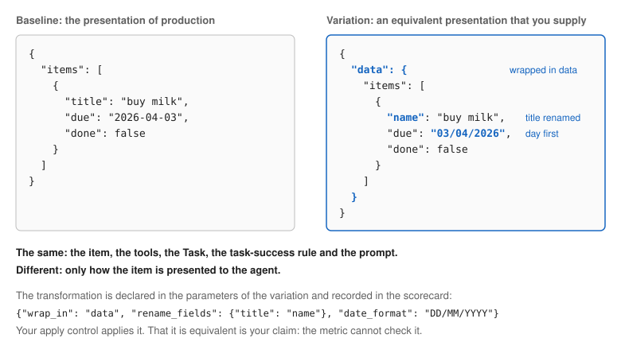
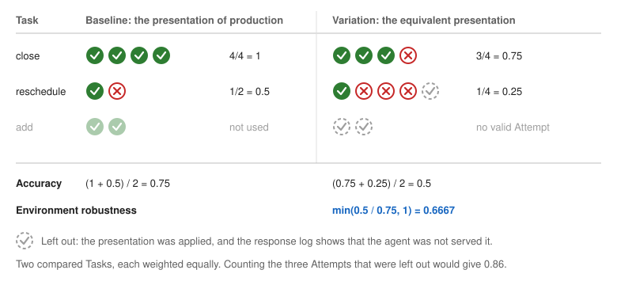

# Environment robustness

Environment robustness measures how much of its baseline task success an agent keeps when the same tools and data are presented to it in an equivalent, different way: other field names, another date format, a response that is wrapped or ordered differently.

You supply the equivalent presentation and the tool that can serve it. Your apply control puts it in place, and the Evaluator sweep attempts each Task under the baseline and under the presentation and compares the accuracy under the two conditions. The offering generates no presentation and changes nothing your tools return.

Four things the value does not tell you:

- **The ratio cannot detect a presentation that changed the Task.** That the presentation is equivalent is your claim. If it drops a field the Task needs, or changes what a value means, the agent loses success and the value falls exactly as it does for an agent that is not robust. Nothing in the number tells the two apart.
- **The cap hides improvement.** The value is capped at 1. A value of 1 says that the agent did at least as well under the presentation as under the baseline. The ratio before the cap is in the scorecard.
- **1 does not mean that every Task survived the presentation.** The value compares two averages over Tasks. A Task that got worse can be offset by a Task that got better.
- **It is not task success.** The value is relative to the baseline, so an agent that seldom succeeds can score 1. Read it with the two accuracies.

| | |
| --- | --- |
| Metric identity | `environment_robustness` |
| Definition version | 1.0.0 |
| Source | [Towards a Science of AI Agent Reliability, version 3](https://arxiv.org/html/2602.16666v3), Table 2 |
| Canonical definition | [`src/reliability_evaluators/evaluators/environment_robustness.py`](../../src/reliability_evaluators/evaluators/environment_robustness.py), with the ratio in [`_robustness.py`](../../src/reliability_evaluators/evaluators/_robustness.py) |
| Scale | 0 to 1 |

## What an equivalent presentation is



An environment variation changes how the tools and data look to the agent. It does not change the data, the tools, what the Task asks for, or the wording of the instruction.

- **You supply it.** You decide what counts as equivalent for your agent, and you build the test tool that can serve it.
- **Its transformation is recorded.** The variation declares the transformation in its `parameters`, such as the renamed fields and the date format. A variation of the kind `environment` without parameters is rejected. The parameters are copied to the scorecard, with the experiment and with every Attempt made under it.
- **Your apply control applies it.** The sweep hands the declared parameters to your control and does nothing else. It never looks inside your agent's tools.
- **A reworded instruction is not an environment variation.** It is a prompt variation, which [prompt robustness](../prompt_robustness/readme.md) compares in an experiment of its own. Under an environment variation the agent is given the Task's own prompt.

## How it is calculated

A Task is **compared** when it has at least one valid Attempt under the baseline and at least one valid Attempt under the presentation. For a compared Task, the success frequency under a condition is the share of its valid Attempts under that condition that succeeded.

```
accuracy under a condition = mean of the success frequencies of the compared Tasks under that condition
environment robustness     = min(accuracy under the presentation / baseline accuracy, 1)
```

Every compared Task has the same weight in an accuracy, whatever its number of Attempts.

- 1 means that the accuracy under the presentation is at least the baseline accuracy.
- 0 means that no compared Task succeeded in any valid Attempt under the presentation.
- The value is the ratio of two accuracies. It is not the mean of a ratio per Task, and it is not the share of the baseline successes that survived.

This is the ratio that [fault robustness](../fault_robustness/readme.md) uses, with the same cap and the same cases in which the metric is unavailable. Its documentation shows the cap as a graph and gives two examples of what a value of 1 does and does not say. They hold here unchanged.

### When an Attempt is valid

An Attempt is valid under the condition it was intended for when all of this holds:

- its execution status is `completed`;
- it has an observed condition, reported by your verify control, that says the intended condition occurred;
- it has a task outcome.

The intended condition alone is a label. An Attempt that was intended to run under the presentation, and in which the agent never read anything that the presentation changes, is not an Attempt under the presentation. It is left out with a reason and counted. It is not evidence that the agent tolerates the presentation.

The same rule holds for the baseline. A baseline Attempt in which the agent was served another presentation is left out of the baseline.

## Worked example

Three Tasks of a to-do agent. Under the presentation, the service returns the same items wrapped in `data`, with the title called `name` and dates written day first. 1 is success and 0 is failure. An outcome in brackets belongs to an Attempt in which the presentation was applied and the response log shows that the agent was served no response in it.

| Task | Baseline outcomes | Baseline success frequency | Outcomes under the presentation | Success frequency under the presentation |
| --- | --- | --- | --- | --- |
| `close` | 1, 1, 1, 1 | 4/4 = 1 | 1, 1, 1, 0 | 3/4 = 0.75 |
| `reschedule` | 1, 0 | 1/2 = 0.5 | 1, 0, 0, 0, (1) | 1/4 = 0.25 |
| `add` | 1, 1 | not used | (1), (1) | no valid Attempt: the Task is not compared |

```
baseline accuracy               = (1 + 0.5) / 2 = 0.75
accuracy under the presentation = (0.75 + 0.25) / 2 = 0.5
environment robustness          = min(0.5 / 0.75, 1) = 0.6667
```

The computed value is 0.6666666666666666.



What to notice:

- **The three Attempts in brackets are left out.** All three succeeded, and in none of them did the agent meet the presentation. `add` puts a new item on the list without reading the list, so the presentation of a list never reaches the agent. Counting the three would give a baseline accuracy of (1 + 0.5 + 1) / 3, an accuracy under the presentation of (0.75 + 0.4 + 1) / 3, and the value 0.86. That number would report tolerance of a presentation that the agent mostly did not see.
- **`add` is not compared**, because it has no valid Attempt under the presentation. Its baseline Attempts are left out with it. The scorecard counts the Task and its Attempts as excluded, with reasons.
- **`reschedule` lost half of its success, and the number does not say why.** The agent may misread a day-first date. Or the presentation may not be equivalent for this Task: `03/04` names two different days, and if the Task depends on telling them apart, the presentation changed the Task. Both give 0.25. `details.per_task` shows which Task lost success. Whether the presentation was fair to it is for you to check.
- **Tasks are weighted equally.** Pooling the valid Attempts of the two compared Tasks would give a baseline accuracy of 5/6, an accuracy under the presentation of 4/8, and 0.6. The mean of the ratio per Task would give (0.75/1 + 0.25/0.5) / 2 = 0.625. Neither is this metric.

## Running the Evaluator on its own

The Evaluator is a pure function. It needs no agent, no sweep and no Foundry project, only Attempts grouped by Task. Each Attempt says which condition it was intended for, as the baseline or as a variation whose kind is `environment`, and what was observed:

```python
from reliability_evaluators.evaluators import environment_robustness
from reliability_evaluators.evidence import (
    Attempt,
    Condition,
    ExecutionStatus,
    ObservedCondition,
    TaskOutcome,
    group_by_task,
)

BASELINE = Condition(condition_id="baseline", description="The service presents items as it does in production.")
DAY_FIRST = Condition(
    condition_id="wrapped-renamed-day-first",
    kind="environment",
    description="The same items, wrapped in 'data', with the title called 'name' and dates written day first.",
    parameters={"wrap_in": "data", "rename_fields": {"title": "name"}, "date_format": "DD/MM/YYYY"},
)
RESPONSE_LOG = "response log of the to-do test service"


def attempts(task_id, condition, outcomes, presentation_not_served_in=()):
    role = "baseline" if condition is BASELINE else "variation"
    return [
        Attempt(
            attempt_id=f"{task_id}/{condition.condition_id}/attempt-{number}",
            task_id=task_id,
            execution_status=ExecutionStatus.COMPLETED,
            task_outcome=TaskOutcome(success=outcome, source="final state of the to-do test service"),
            intended_condition=condition,
            condition_role=role,
            observed_condition=ObservedCondition(met=number not in presentation_not_served_in, source=RESPONSE_LOG),
        )
        for number, outcome in enumerate(outcomes, start=1)
    ]


evidence = [
    *attempts("close", BASELINE, [1, 1, 1, 1]),
    *attempts("close", DAY_FIRST, [1, 1, 1, 0]),
    *attempts("reschedule", BASELINE, [1, 0]),
    *attempts("reschedule", DAY_FIRST, [1, 0, 0, 0, 1], presentation_not_served_in={5}),
    *attempts("add", BASELINE, [1, 1]),
    *attempts("add", DAY_FIRST, [1, 1], presentation_not_served_in={1, 2}),
]

result = environment_robustness.evaluate(group_by_task(evidence))

result.state.value                               # "available"
result.value                                     # 0.6666666666666666
result.details["baseline"]["accuracy"]           # 0.75
result.details["environment"]["accuracy"]        # 0.5
result.details["accuracy_ratio"]                 # 0.6666666666666666
result.details["capped"]                         # False
result.counts["tasks"].to_dict()                 # {"total": 3, "valid": 2, "missing": [], "excluded": [
                                                 #   {"reason": "no valid Attempt under the environment variation",
                                                 #    "count": 1, "ids": ["add"]}]}
result.counts["environment_attempts"].to_dict()  # {"total": 11, "valid": 8, "missing": [], "excluded": [
                                                 #   {"reason": "the observed condition differs from the intended condition",
                                                 #    "count": 3, "ids": ["reschedule/wrapped-renamed-day-first/attempt-5",
                                                 #                        "add/wrapped-renamed-day-first/attempt-1",
                                                 #                        "add/wrapped-renamed-day-first/attempt-2"]}]}
result.attempt_ids                               # the 14 Attempts the value rests on
```

Give the Evaluator the Attempts of the experiments that declare an environment variation. It treats every baseline Attempt of a Task as the baseline of that Task, and it leaves out and counts an Attempt made under a fault or under a prompt variation.

## Running it through an Evaluator sweep

Declare a [controlled experiment](../sweep/controlled-experiments.md) for each Task, with a variation whose `kind` is `"environment"` and whose `parameters` are the transformation, and select the metric. You supply the tool that can serve the presentation and the four controls that operate it:

```python
from reliability_evaluators.evidence import TaskOutcome
from reliability_evaluators.scorecard import to_json
from reliability_evaluators.sweep import Condition, Experiment, ObservedCondition, Task, run_sweep


class TodoControls:
    def prepare_state(self, context):
        for resource in context.authorized_resources:
            my_test_service.reset(resource)

    def apply_condition(self, context):
        # The tools your agent calls answer in this presentation while it is set. The baseline declares
        # no parameters, which sets none. The sweep cannot change what your tools return.
        my_test_service.set_presentation(context.condition.parameters or None)
        my_test_service.clear_response_log()

    def verify_condition(self, context):
        # Evidence of what the agent was served in this Attempt, from the response log of the service.
        presented = my_test_service.count_responses_in_a_presentation()
        plain = my_test_service.count_plain_responses()
        if context.condition_role == "variation":
            met = presented > 0 and plain == 0
        else:
            met = presented == 0
        return ObservedCondition(
            met=met,
            source="response log of the to-do test service",
            observations={"responses_in_a_presentation": presented, "plain_responses": plain},
        )

    def clean_up(self, context):
        my_test_service.set_presentation(None)


def item_is_closed(attempt, response):
    # Decide from independent evidence, such as service state, not from the response text.
    closed = my_test_service.item_is_closed("todo-list/reliability-test")
    return TaskOutcome(success=closed, source="final state of the to-do test service")


experiment = Experiment(
    experiment_id="close-item-day-first",
    task=Task(task_id="close", prompt="Close the item 'buy milk'.", success_rule=item_is_closed, attempts=4),
    agent_configuration={"agent": "todo-agent", "version": "3", "model": "gpt-4.1"},
    starting_state="fresh",
    baseline=Condition(condition_id="baseline", description="The service presents items as it does in production."),
    variation=Condition(
        condition_id="wrapped-renamed-day-first",
        kind="environment",
        description="The same items, wrapped in 'data', with the title called 'name' and dates written day first.",
        parameters={"wrap_in": "data", "rename_fields": {"title": "name"}, "date_format": "DD/MM/YYYY"},
    ),
    controls=TodoControls(),
    write_capable=True,
    authorized_resources=["todo-list/reliability-test"],
)

scorecard = run_sweep(experiments=[experiment], agent_target=my_agent_target, metrics=["environment_robustness"])
print(to_json(scorecard))
```

The sweep makes `attempts` Attempts under the baseline and as many under the presentation, and invokes your controls around each one. The agent is given the same prompt under both. What makes the result trustworthy is in your hands:

- **The presentation must be equivalent.** The same items, the same operations, the same meaning. The sweep cannot check this, and the value cannot show it.
- **The verify control must observe, not repeat.** It should read evidence of what the agent was served in this Attempt, such as the response log of your test tool. When it reports that the presentation was not served, raises, or returns anything other than an `ObservedCondition`, the Attempt gets the execution status `condition_not_met` and is left out of the metric.
- **The task-success rule must read independent evidence.** The metric uses the task outcome your rule returns, with its source, and never the agent's answer. The same rule judges both conditions, so it must not depend on the presentation.
- **Everything else is held fixed.** The baseline and the variation differ only in the declared presentation. An experiment has one variation, and a variation has one kind: a presentation is never combined with a fault or with a reworded instruction in one condition.

The same Attempts can feed other metrics in the same sweep. Outcome consistency and the other metrics of repeated Attempts are scored on the baseline Attempts only: see [several Evaluators in one sweep](../sweep/several-evaluators.md).

The sweep rejects the selection of `environment_robustness` before any Attempt is made when no experiment declares a variation of the kind `environment`. Environment robustness uses only the experiments that do. Experiments that declare a fault or a prompt variation are not part of it.

To measure fault robustness, environment robustness and prompt robustness for the same work, declare one experiment for each kind of variation. A Task can be declared in one experiment only, so each of the three has a Task of its own, with the same prompt and the same task-success rule and its own task identity.

## Scoring it in your Foundry project

Environment robustness can also be calculated by a custom evaluator in your own Foundry project. That evaluator is derived from the canonical definition above; there is no second formula. Select the metric as `ConfiguredEvaluator(metric_id="environment_robustness", scoring_path="foundry_managed")` and give the sweep your project as `managed_scoring`. Everything else is declared as above.

For each Attempt the evaluator is sent its identity, its Task, its execution status, and its task outcome, the condition it was intended for with its role, kind, description and parameters, the observed condition with its source and observations, and the prompt variant it ran under, if any. Nothing else about the Attempt leaves your process.

The value is then the number Foundry returned. It is reported with `scoring_path` `foundry_managed`. Its `fidelity` is `authoritative` when it equals the value the evaluator returned with it in encoded form, and `unverified`, with its limitation, when it does not: see [the fidelity check](../managed_scoring/readme.md#the-fidelity-check) for what that establishes. An unverified result cannot be met or not met by an acceptance criterion. Only the metric value is compared in that way. The state, the reason, the counts and the details, with the two accuracies and the ratio before the cap, are the ones the evaluator returned from Foundry in the encoded result, and they are what your own process gives for the same evidence. An unavailable measurement comes back as one.

A sweep that is too large for one managed run has no result for the metric, and the scorecard says so. With Tasks of five Attempts, the largest synthetic sweep that fitted had 470 Attempts. See [Foundry-managed scoring](../managed_scoring/readme.md) and its [limits](../managed_scoring/readme.md#limits).

## In the scorecard

| Field | Content |
| --- | --- |
| `state`, `value`, `reason` | `available` with a value, or `unavailable` with a reason and no value |
| `definition` | version, what it measures, the calculation, the fidelity conventions, the scale and the interpretation |
| `scoring_path`, `fidelity` | `customer_process` and `authoritative` for a value scored in your own process |
| `counts.tasks` | `total`: the Tasks of the experiments that declare an environment variation. `valid`: the compared Tasks. `excluded`: the Tasks that lack a valid Attempt under the baseline, under the presentation, or under both, with their identities |
| `counts.baseline_attempts`, `counts.environment_attempts` | per condition, `total`: the Attempts intended for it. `valid`: the Attempts the accuracy rests on. `missing` and `excluded`: the Attempts left out, each with a reason and the Attempt identities |
| `counts.other_attempts` | Attempts that were intended for neither condition. The sweep passes none; it matters when you call the Evaluator on its own |
| `details.baseline`, `details.environment` | per condition: the accuracy, the compared Tasks, the compared Attempts and their successes, the number of Tasks with a valid Attempt, the identities of the conditions and what their occurrence was observed from |
| `details.accuracy_ratio`, `details.capped` | the ratio before the cap, and whether the cap applied |
| `details.per_task` | the Attempts, the successes and the success frequency of each compared Task under each condition |
| `evidence.attempt_ids` | the Attempts the value rests on, which are listed under `attempts` in the same scorecard |
| `attempts_used` | every Attempt this Evaluator was given, under the baseline and under the presentation, whatever became of it, and the other metrics scored from any of the same Attempts: see [several Evaluators in one sweep](../sweep/several-evaluators.md) |
| `acceptance` | the assessment of your acceptance criterion for this metric, or `null` when you declared none: see [acceptance criteria](../acceptance_criteria/readme.md) |

The transformation is recorded twice. `experiments` lists each experiment with its `variation`, which carries `"kind": "environment"` and the `parameters` you declared. Each Attempt under `attempts` carries the same in its `intended_condition`, together with its `observed_condition`, which holds the source and the observations of your verify control, and its `task_outcome` with its source.

An acceptance criterion can require a minimum number of valid items of any of these evidence units, for example `{"value": {"at_least": 0.8}, "minimum_counts": {"tasks": 5, "environment_attempts": 25}}`.

## Evidence it needs

Each Attempt must identify itself and its Task, and carry:

- the condition it was intended for: a `Condition` and its role, `baseline` or `variation`. A variation is an environment variation when its `Condition` declares `kind="environment"`, and it then declares its transformation in `parameters`. A baseline declares no kind;
- an observed condition with its source, which says whether the intended condition occurred;
- an execution status, which is separate from the task outcome;
- a task outcome that is binary and records its source.

A condition that is only a label is rejected with an error, and so is an environment variation without parameters, an observed condition without a source, a kind of variation that does not exist, a baseline that declares a kind, and two Attempts with the same identity.

## What is left out, and when the metric is unavailable

These are the cases of fault robustness, with the environment variation in the place of the fault.

| Situation | Treatment |
| --- | --- |
| An Attempt whose observed condition says the intended condition did not occur | Excluded from that condition: `the observed condition differs from the intended condition`. This includes an Attempt under the presentation in which the agent was not served it, and a baseline Attempt in which it was. |
| An Attempt with no observed condition | Excluded from that condition: `no observed condition shows that the intended condition occurred`. A label is not evidence. |
| An Attempt whose execution status is not `completed`, for another reason | Excluded: `execution status is not completed`. It is not a task failure. |
| A valid Attempt of a Task that has no valid Attempt under the other condition | Excluded: `its Task has no valid Attempt under the environment variation`, or `under the baseline`. |
| A completed Attempt under its intended condition with no task outcome | Counted as missing: `no task outcome recorded`. |
| A Task without a valid Attempt under one condition or under both | The Task is excluded: `no valid Attempt under the baseline`, `no valid Attempt under the environment variation`, or `no valid Attempt under either condition`. |
| An Attempt intended for neither condition, such as one under a fault | Counted under `other_attempts`: `not made under the baseline or under an environment variation`. |
| Neither condition has a valid Attempt | Unavailable measurement: `no valid Attempt under the baseline and none under the environment variation`. |
| One condition has no valid Attempt | Unavailable measurement: `no valid Attempt under the baseline`, or `no valid Attempt under the environment variation`. |
| Both conditions have valid Attempts, and no Task has them under both | Unavailable measurement: `no Task has a valid Attempt under both the baseline and the environment variation`. |
| The baseline accuracy is zero | Unavailable measurement: `the baseline accuracy is zero, so the ratio is undefined`. This holds when the accuracy under the presentation is zero as well. |

An unavailable measurement carries its reason and the evidence counts. It never carries a number. In particular, a presentation that the agent never met does not give 1, and a baseline that never succeeds gives neither 0 nor 1.

In a sweep, an experiment that was stopped, or was not started because an earlier experiment left its test resources unrestored, is still a Task of the comparison. It is counted as an excluded Task.

## Fidelity conventions

- The formula is the one in paper v3 Table 2: `min(Acc_pert / Acc_0, 1)`. It is the ratio of two accuracies, not the mean of a ratio per Task and not the share of the baseline successes that survived.
- You supply the presentation, and the offering generates none. The paper generates structural perturbations at a mild, medium or severe intensity: other key names, date and number formats, wrapped or nested responses, renamed tool parameters. Those are settings of its experiments and not part of the metric.
- The paper asserts that its perturbations preserve meaning and does not prove it. Neither does this Evaluator: equivalence is your claim, and the ratio cannot detect a presentation that changed the Task.
- An Attempt counts under the presentation only when its observed condition shows that the agent was served the presentation in that Attempt. The same holds for the baseline.
- An environment variation does not reword the instruction. The paper first separates environment changes from instruction changes and then rephrases questions under its environment perturbation, so its two factors overlap in that example. Here a reworded instruction belongs to [prompt robustness](../prompt_robustness/readme.md) only, and an experiment has one kind of variation.
- The paper also calls this metric `R_struct`, and calls structural perturbation a tractable proxy for a wider notion of environment. The value says nothing about a change of infrastructure or of the domain.
- The paper leaves a baseline accuracy of zero undefined, and its companion code returns no number below 1e-8. Here the metric is an unavailable measurement when the baseline accuracy is exactly zero. No epsilon is used: a small baseline accuracy that is not zero gives a value, and that value rests on few successes. Read the counts.
- No minimum number of Attempts or Tasks is imposed and no confidence interval is reported. The counts are the statistical disclosure.

## Assumptions

These come from the specification and are not confirmed decisions. They are the assumptions of fault robustness, and they are implemented as written.

1. **Accuracy is task-balanced** (specification assumption 8). It is the equal-weight mean across Tasks of the success frequency per Task, over the Tasks present in both conditions, and it is not pooled over Attempts. The paper states accuracy across tasks and its companion code pools Attempts without matching Tasks between the conditions. The choice changes the value whenever Tasks differ in their number of valid Attempts. In the worked example it is 0.6667 against 0.6.
2. **An Attempt whose observed condition differs from the intended one is excluded from that condition** (specification assumption 14). It is excluded with a reason and counted. It is not moved to the condition that was observed.

This version reads "present in both conditions" as: the Task has at least one valid Attempt under each. The specification does not say more than that.

## Numbers

Values are IEEE 754 double-precision numbers and are written to the scorecard without rounding. The two accuracies and their ratio are computed as exact fractions of whole numbers, and each is converted to a double once, so 0.5 / 0.75 gives the double nearest to 2/3, which prints as 0.6666666666666666. The success frequency of a Task is its successes divided by its Attempts.
