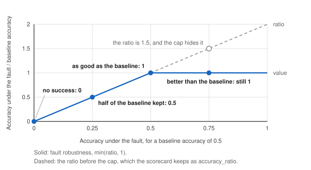
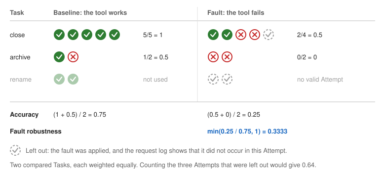

# Fault robustness

Fault robustness measures how much of its baseline task success an agent keeps when one of its tools fails.

You supply a tool that fails on demand. The Evaluator sweep attempts each Task under the baseline, where the tool works, and under the fault, and compares the accuracy under the two conditions. An Attempt counts under the fault only when your verify control shows that the fault occurred during that Attempt. **A fault label is not evidence.**

Three things the value does not tell you:

- **The cap hides improvement.** The value is capped at 1. A value of 1 says that the agent did at least as well under the fault as under the baseline. It does not say how much better it did. The ratio before the cap is in the scorecard.
- **1 does not mean that every Task survived the fault.** The value compares two averages over Tasks. A Task that got worse under the fault can be offset by a Task that got better.
- **It is not task success.** The value is relative to the baseline, so an agent that seldom succeeds can score 1. Read it with the two accuracies.

| | |
| --- | --- |
| Metric identity | `fault_robustness` |
| Definition version | 1.0.0 |
| Source | [Towards a Science of AI Agent Reliability, version 3](https://arxiv.org/html/2602.16666v3), Table 2 |
| Canonical definition | [`src/reliability_evaluators/evaluators/fault_robustness.py`](../../src/reliability_evaluators/evaluators/fault_robustness.py), with the ratio in [`_robustness.py`](../../src/reliability_evaluators/evaluators/_robustness.py) |
| Scale | 0 to 1 |

## How it is calculated

A Task is **compared** when it has at least one valid Attempt under the baseline and at least one valid Attempt under the fault. For a compared Task, the success frequency under a condition is the share of its valid Attempts under that condition that succeeded.

```
accuracy under a condition = mean of the success frequencies of the compared Tasks under that condition
fault robustness           = min(accuracy under the fault / baseline accuracy, 1)
```

Every compared Task has the same weight in an accuracy, whatever its number of Attempts.



- 1 means that the accuracy under the fault is at least the baseline accuracy.
- 0 means that no compared Task succeeded in any valid Attempt under the fault.
- The value is the ratio of two accuracies. It is not the mean of a ratio per Task, and it is not the share of the baseline successes that survived the fault.

### When an Attempt is valid

An Attempt is valid under the condition it was intended for when all of this holds:

- its execution status is `completed`;
- it has an observed condition, reported by your verify control, that says the intended condition occurred;
- it has a task outcome.

The intended condition alone is a label. An Attempt that was intended to run under the fault, and in which the fault was applied but never occurred because the agent did not call the failing tool, is not an Attempt under the fault. It is left out with a reason and counted. It is not evidence that the agent tolerates the fault.

The same rule holds for the baseline. A baseline Attempt in which a fault was observed is left out of the baseline.

## Worked example

Three Tasks of a to-do agent. Under the fault, the service refuses to update an item. 1 is success and 0 is failure. An outcome in brackets belongs to an Attempt in which the fault was applied and the request log shows that it did not occur.

| Task | Baseline outcomes | Baseline success frequency | Outcomes under the fault | Success frequency under the fault |
| --- | --- | --- | --- | --- |
| `close` | 1, 1, 1, 1, 1 | 5/5 = 1 | 1, 1, 0, 0, (1) | 2/4 = 0.5 |
| `archive` | 1, 0 | 1/2 = 0.5 | 0, 0 | 0/2 = 0 |
| `rename` | 1, 1 | not used | (1), (1) | no valid Attempt: the Task is not compared |

```
baseline accuracy        = (1 + 0.5) / 2 = 0.75
accuracy under the fault = (0.5 + 0) / 2 = 0.25
fault robustness         = min(0.25 / 0.75, 1) = 0.3333
```

The computed value is 0.3333333333333333.



What to notice:

- **The three Attempts in brackets are left out.** All three succeeded, and none of them met the fault. Counting them as Attempts under the fault would give a baseline accuracy of (1 + 0.5 + 1) / 3, an accuracy under the fault of (0.6 + 0 + 1) / 3, and the value 0.64. That number would report tolerance of a fault that mostly did not occur.
- **`rename` is not compared**, because it has no valid Attempt under the fault. Its baseline Attempts are left out with it. The scorecard counts the Task and its Attempts as excluded, with reasons.
- **Tasks are weighted equally.** Pooling the valid Attempts of the two compared Tasks would give a baseline accuracy of 6/7, an accuracy under the fault of 2/6, and 0.3889. The mean of the ratio per Task would give (0.5/1 + 0/0.5) / 2 = 0.25. Neither is this metric.

## What a value of 1 does and does not say

**The cap hides improvement.** One Task, four Attempts under each condition:

| Baseline outcomes | Outcomes under the fault | Ratio | Value |
| --- | --- | --- | --- |
| 1, 1, 0, 0 (0.5) | 1, 1, 0, 0 (0.5) | 0.5 / 0.5 = 1 | 1 |
| 1, 1, 0, 0 (0.5) | 1, 1, 1, 0 (0.75) | 0.75 / 0.5 = 1.5 | 1 |

Both agents score 1. The scorecard keeps the ratio before the cap as `details.accuracy_ratio` and says whether the cap applied in `details.capped`. A ratio above 1 is worth a look of its own: it can mean that the baseline is unstable, or that the fault makes the Task easier.

**1 does not mean that every Task survived the fault.** Two Tasks, four Attempts under each condition:

| Task | Baseline success frequency | Success frequency under the fault |
| --- | --- | --- |
| `weak` | 2/4 = 0.5 | 4/4 = 1 |
| `strong` | 4/4 = 1 | 2/4 = 0.5 |
| Accuracy | (0.5 + 1) / 2 = 0.75 | (1 + 0.5) / 2 = 0.75 |

The value is 0.75 / 0.75 = 1, and the cap did not apply. `strong` lost half of its successes under the fault. `details.per_task` gives the Attempts, the successes and the success frequency of every compared Task under each condition, so a Task that got worse stays visible.

## Running the Evaluator on its own

The Evaluator is a pure function. It needs no agent, no sweep and no Foundry project, only Attempts grouped by Task. Each Attempt says which condition it was intended for, as the baseline or as a variation whose kind is `fault`, and what was observed:

```python
from reliability_evaluators.evaluators import fault_robustness
from reliability_evaluators.evidence import (
    Attempt,
    Condition,
    ExecutionStatus,
    ObservedCondition,
    TaskOutcome,
    group_by_task,
)

BASELINE = Condition(condition_id="baseline", description="Every operation works.")
UPDATE_FAILS = Condition(condition_id="update-fails", kind="fault", description="The update operation returns 503.")
REQUEST_LOG = "request log of the to-do test service"


def attempts(task_id, condition, outcomes, fault_did_not_occur_in=()):
    role = "baseline" if condition is BASELINE else "variation"
    return [
        Attempt(
            attempt_id=f"{task_id}/{condition.condition_id}/attempt-{number}",
            task_id=task_id,
            execution_status=ExecutionStatus.COMPLETED,
            task_outcome=TaskOutcome(success=outcome, source="final state of the to-do test service"),
            intended_condition=condition,
            condition_role=role,
            observed_condition=ObservedCondition(met=number not in fault_did_not_occur_in, source=REQUEST_LOG),
        )
        for number, outcome in enumerate(outcomes, start=1)
    ]


evidence = [
    *attempts("close", BASELINE, [1, 1, 1, 1, 1]),
    *attempts("close", UPDATE_FAILS, [1, 1, 0, 0, 1], fault_did_not_occur_in={5}),
    *attempts("archive", BASELINE, [1, 0]),
    *attempts("archive", UPDATE_FAILS, [0, 0]),
    *attempts("rename", BASELINE, [1, 1]),
    *attempts("rename", UPDATE_FAILS, [1, 1], fault_did_not_occur_in={1, 2}),
]

result = fault_robustness.evaluate(group_by_task(evidence))

result.state.value                          # "available"
result.value                                # 0.3333333333333333
result.details["baseline"]["accuracy"]      # 0.75
result.details["fault"]["accuracy"]         # 0.25
result.details["accuracy_ratio"]            # 0.3333333333333333
result.details["capped"]                    # False
result.counts["tasks"].to_dict()            # {"total": 3, "valid": 2, "missing": [], "excluded": [
                                            #   {"reason": "no valid Attempt under the fault variation",
                                            #    "count": 1, "ids": ["rename"]}]}
result.counts["fault_attempts"].to_dict()   # {"total": 9, "valid": 6, "missing": [], "excluded": [
                                            #   {"reason": "the observed condition differs from the intended condition",
                                            #    "count": 3, "ids": ["close/update-fails/attempt-5",
                                            #                        "rename/update-fails/attempt-1",
                                            #                        "rename/update-fails/attempt-2"]}]}
result.attempt_ids                          # the 13 Attempts the value rests on
```

Give the Evaluator the Attempts of the experiments that declare a fault. It treats every baseline Attempt of a Task as the baseline of that Task.

## Running it through an Evaluator sweep

Declare a [controlled experiment](../sweep/controlled-experiments.md) for each Task, with a variation whose `kind` is `"fault"`, and select the metric. You supply the tool that fails on demand and the four controls that operate it:

```python
from reliability_evaluators.evidence import TaskOutcome
from reliability_evaluators.scorecard import to_json
from reliability_evaluators.sweep import Condition, Experiment, ObservedCondition, Task, run_sweep


class TodoControls:
    def prepare_state(self, context):
        for resource in context.authorized_resources:
            my_test_service.reset(resource)

    def apply_condition(self, context):
        # The tool your agent calls fails while this is set. The sweep cannot make it fail for you.
        my_test_service.set_fault(context.condition.parameters.get("failing_operation"))
        my_test_service.clear_request_log()

    def verify_condition(self, context):
        # Evidence that the fault occurred in this Attempt: the service refused at least one request.
        refused = my_test_service.count_refused_requests()
        intended = "failing_operation" in context.condition.parameters
        return ObservedCondition(
            met=(refused > 0) == intended,
            source="request log of the to-do test service",
            observations={"refused_requests": refused},
        )

    def clean_up(self, context):
        my_test_service.set_fault(None)


def item_is_closed(attempt, response):
    # Decide from independent evidence, such as service state, not from the response text.
    closed = my_test_service.item_is_closed("todo-list/reliability-test")
    return TaskOutcome(success=closed, source="final state of the to-do test service")


experiment = Experiment(
    experiment_id="close-item-under-update-fault",
    task=Task(task_id="close", prompt="Close the item.", success_rule=item_is_closed, attempts=5),
    agent_configuration={"agent": "todo-agent", "version": "3", "model": "gpt-4.1"},
    starting_state="fresh",
    baseline=Condition(condition_id="baseline", description="Every operation works."),
    variation=Condition(
        condition_id="update-fails",
        kind="fault",
        description="The update operation returns 503.",
        parameters={"failing_operation": "update"},
    ),
    controls=TodoControls(),
    write_capable=True,
    authorized_resources=["todo-list/reliability-test"],
)

scorecard = run_sweep(experiments=[experiment], agent_target=my_agent_target, metrics=["fault_robustness"])
print(to_json(scorecard))
```

The sweep makes `attempts` Attempts under the baseline and as many under the fault, and invokes your controls around each one. What makes the result trustworthy is in your hands:

- **The verify control must observe, not repeat.** It should read evidence that the fault occurred in this Attempt, such as the request log of the failing tool. When it reports that the fault did not occur, raises, or returns anything other than an `ObservedCondition`, the Attempt gets the execution status `condition_not_met` and is left out of the metric.
- **The task-success rule must read independent evidence.** An agent can answer that it is done after a tool call failed. The metric uses the task outcome your rule returns, with its source, and never the agent's answer.
- **Everything else is held fixed.** The baseline and the fault differ only in the declared fault.

The same Attempts can feed other metrics in the same sweep. Outcome consistency and the other metrics of repeated Attempts are scored on the baseline Attempts only, so selecting `outcome_consistency` and `fault_robustness` together makes each Attempt once: see [several Evaluators in one sweep](../sweep/several-evaluators.md).

The sweep rejects the selection of `fault_robustness` before any Attempt is made when no experiment declares a variation of the kind `fault`. Fault robustness uses only the experiments that do. Experiments with a baseline only and experiments whose variation declares no kind are not part of it.

## Scoring it in your Foundry project

Fault robustness can also be calculated by a custom evaluator in your own Foundry project. That evaluator is derived from the canonical definition above; there is no second formula. Select the metric as `ConfiguredEvaluator(metric_id="fault_robustness", scoring_path="foundry_managed")` and give the sweep your project as `managed_scoring`. Everything else is declared as above.

For each Attempt the evaluator is sent its identity, its Task, its execution status, and its task outcome, the condition it was intended for with its role, kind, description and parameters, the observed condition with its source and observations, and the prompt variant it ran under, if any. Nothing else about the Attempt leaves your process.

The value is then the number Foundry returned. It is reported with `scoring_path` `foundry_managed`. Its `fidelity` is `authoritative` when it equals the value the evaluator returned with it in encoded form, and `unverified`, with its limitation, when it does not: see [the fidelity check](../managed_scoring/readme.md#the-fidelity-check) for what that establishes. An unverified result cannot be met or not met by an acceptance criterion. Only the metric value is compared in that way. The state, the reason, the counts and the details, with the two accuracies and the ratio before the cap, are the ones the evaluator returned from Foundry in the encoded result, and they are what your own process gives for the same evidence. An unavailable measurement comes back as one.

A sweep that is too large for one managed run has no result for the metric, and the scorecard says so. With Tasks of five Attempts, the largest synthetic sweep that fitted had 475 Attempts. See [Foundry-managed scoring](../managed_scoring/readme.md) and its [limits](../managed_scoring/readme.md#limits).

## In the scorecard

| Field | Content |
| --- | --- |
| `state`, `value`, `reason` | `available` with a value, or `unavailable` with a reason and no value |
| `execution_failure` | `null`, unless the metric has no result because the Attempts that supply its evidence were cut short; see [execution limits and partial scorecards](../sweep/execution-limits.md#metrics-in-a-partial-scorecard) |
| `cut_short` | The experiments whose Attempts for this metric were cut short. `task_ids` is retained for earlier scorecards |
| `definition` | version, what it measures, the calculation, the fidelity conventions, the scale and the interpretation |
| `scoring_path`, `fidelity` | `customer_process` and `authoritative` for a value scored in your own process |
| `counts.tasks` | `total`: the Tasks of the experiments that declare a fault. `valid`: the compared Tasks. `excluded`: the Tasks that lack a valid Attempt under the baseline, under the fault, or under both, with their identities |
| `counts.baseline_attempts`, `counts.fault_attempts` | per condition, `total`: the Attempts intended for it. `valid`: the Attempts the accuracy rests on. `missing` and `excluded`: the Attempts left out, each with a reason and the Attempt identities |
| `counts.other_attempts` | Attempts that were intended for neither condition. The sweep passes none; it matters when you call the Evaluator on its own |
| `details.baseline`, `details.fault` | per condition: the accuracy, the compared Tasks, the compared Attempts and their successes, the number of Tasks with a valid Attempt, the identities of the conditions and what their occurrence was observed from |
| `details.accuracy_ratio`, `details.capped` | the ratio before the cap, and whether the cap applied |
| `details.per_task` | the Attempts, the successes and the success frequency of each compared Task under each condition |
| `evidence.attempt_ids` | the Attempts the value rests on, which are listed under `attempts` in the same scorecard |
| `attempts_used` | every Attempt this Evaluator was given, under the baseline and under the fault, whatever became of it, and the other metrics scored from any of the same Attempts: see [several Evaluators in one sweep](../sweep/several-evaluators.md) |
| `acceptance` | the assessment of your acceptance criterion for this metric, or `null` when you declared none: see [acceptance criteria](../acceptance_criteria/readme.md) |

Each Attempt under `attempts` carries its `intended_condition`, with `"kind": "fault"` for an Attempt under the fault, its `observed_condition` with the source and the observations of your verify control, and its `task_outcome` with its source.

An acceptance criterion can require a minimum number of valid items of any of these evidence units, for example `{"value": {"at_least": 0.8}, "minimum_counts": {"tasks": 5, "fault_attempts": 25}}`.

## Evidence it needs

Each Attempt must identify itself and its Task, and carry:

- the condition it was intended for: a `Condition` and its role, `baseline` or `variation`. A variation is a fault when its `Condition` declares `kind="fault"`. A baseline declares no kind;
- an observed condition with its source, which says whether the intended condition occurred;
- an execution status, which is separate from the task outcome;
- a task outcome that is binary and records its source.

A condition that is only a label is rejected with an error, and so is an observed condition without a source, a kind of variation that does not exist, a baseline that declares a kind, and two Attempts with the same identity.

## What is left out, and when the metric is unavailable

| Situation | Treatment |
| --- | --- |
| An Attempt whose observed condition says the intended condition did not occur | Excluded from that condition: `the observed condition differs from the intended condition`. This includes an Attempt under the fault in which the fault did not occur, and a baseline Attempt in which a fault occurred. |
| An Attempt with no observed condition | Excluded from that condition: `no observed condition shows that the intended condition occurred`. A label is not evidence. |
| An Attempt whose execution status is not `completed`, for another reason | Excluded: `execution status is not completed`. It is not a task failure. |
| A valid Attempt of a Task that has no valid Attempt under the other condition | Excluded: `its Task has no valid Attempt under the fault variation`, or `under the baseline`. |
| A completed Attempt under its intended condition with no task outcome | Counted as missing: `no task outcome recorded`. |
| A Task without a valid Attempt under one condition or under both | The Task is excluded: `no valid Attempt under the baseline`, `no valid Attempt under the fault variation`, or `no valid Attempt under either condition`. |
| An Attempt intended for neither condition | Counted under `other_attempts`: `not made under the baseline or under a fault variation`. |
| Neither condition has a valid Attempt | Unavailable measurement: `no valid Attempt under the baseline and none under the fault variation`. |
| One condition has no valid Attempt | Unavailable measurement: `no valid Attempt under the baseline`, or `no valid Attempt under the fault variation`. |
| Both conditions have valid Attempts, and no Task has them under both | Unavailable measurement: `no Task has a valid Attempt under both the baseline and the fault variation`. |
| The baseline accuracy is zero | Unavailable measurement: `the baseline accuracy is zero, so the ratio is undefined`. This holds when the accuracy under the fault is zero as well. |

An unavailable measurement carries its reason and the evidence counts. It never carries a number. In particular, a fault that never occurred does not give 1, and a baseline that never succeeds gives neither 0 nor 1.

In a sweep, an experiment that was stopped, or was not started because an earlier experiment left its test resources unrestored, is still a Task of the comparison. It is counted as an excluded Task. When no value can be calculated from what such experiments left, the metric has no result: that is an execution failure and not an unavailable measurement, and the scorecard is partial.

## Fidelity conventions

- The formula is the one in paper v3 Table 2: `min(Acc_fault / Acc_0, 1)`. It is the ratio of two accuracies, not the mean of a ratio per Task and not the share of the baseline successes that survived.
- An Attempt counts under the fault only when its observed condition shows that the fault occurred in that Attempt. The paper injects faults with a probability per tool call and does not require that an Attempt met one. A configured fault rate and an applied fault are not evidence of exposure here.
- The same holds for the baseline: an Attempt counts under the baseline only when its observed condition shows that the baseline occurred.
- The paper leaves a baseline accuracy of zero undefined, and its companion code returns no number below 1e-8. Here the metric is an unavailable measurement when the baseline accuracy is exactly zero. No epsilon is used: a small baseline accuracy that is not zero gives a value, and that value rests on few successes. Read the counts.
- The paper's fault rate, its mix of fault types and its recovery policy are settings of its experiments and not part of the metric. You declare the fault and supply the tool that fails on demand. The offering injects nothing.
- No minimum number of Attempts or Tasks is imposed and no confidence interval is reported. The counts are the statistical disclosure.

## Assumptions

These come from the specification and are not confirmed decisions. They are implemented as written.

1. **Accuracy is task-balanced** (specification assumption 8). It is the equal-weight mean across Tasks of the success frequency per Task, over the Tasks present in both conditions, and it is not pooled over Attempts. The paper states accuracy across tasks and its companion code pools Attempts without matching Tasks between the conditions. The choice changes the value whenever Tasks differ in their number of valid Attempts. In the worked example it is 0.3333 against 0.3889.
2. **An Attempt whose observed condition differs from the intended one is excluded from that condition** (specification assumption 14). It is excluded with a reason and counted. It is not moved to the condition that was observed.

This version reads "present in both conditions" as: the Task has at least one valid Attempt under each. The specification does not say more than that.

## Numbers

Values are IEEE 754 double-precision numbers and are written to the scorecard without rounding. The two accuracies and their ratio are computed as exact fractions of whole numbers, and each is converted to a double once, so 0.25 / 0.75 gives the double nearest to 1/3, which prints as 0.3333333333333333. The success frequency of a Task is its successes divided by its Attempts.
