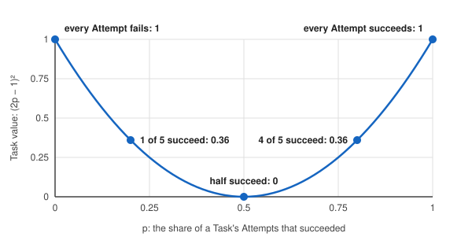
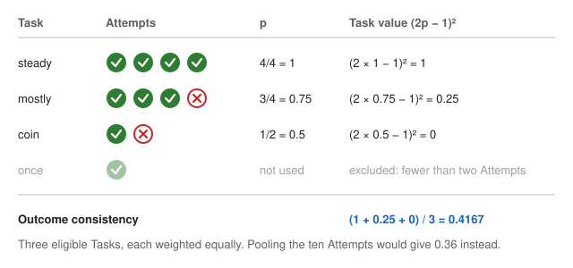

# Outcome consistency

Outcome consistency measures whether repeated Attempts at the same Task give the same task outcome.

It does not measure whether the agent succeeds. **Consistent is not successful**: an agent that fails every Attempt scores 1, exactly like an agent that succeeds every Attempt. Read this metric next to the task outcomes, never instead of them.

| | |
| --- | --- |
| Metric identity | `outcome_consistency` |
| Definition version | 1.0.0 |
| Source | [Towards a Science of AI Agent Reliability, version 3](https://arxiv.org/html/2602.16666v3), Table 2 |
| Canonical definition | [`src/reliability_evaluators/evaluators/outcome_consistency.py`](../../src/reliability_evaluators/evaluators/outcome_consistency.py) |
| Scale | 0 to 1 |

## How it is calculated

For each Task, `p` is the share of its Attempts that succeeded. The Task value is

```
(2p - 1)^2
```

The metric is the mean of the Task values, with every eligible Task weighted equally.



- 1 means every eligible Task gave the same task outcome on all its Attempts.
- 0 means every eligible Task succeeded on exactly half its Attempts.
- The curve is symmetric. Four successes in five Attempts and one success in five Attempts both give 0.36.

## Worked example

Four Tasks, with the task outcome of each Attempt (1 is success, 0 is failure):

| Task | Task outcomes | p | Task value |
| --- | --- | --- | --- |
| `steady` | 1, 1, 1, 1 | 4/4 = 1 | (2 × 1 − 1)² = 1 |
| `mostly` | 1, 1, 1, 0 | 3/4 = 0.75 | (2 × 0.75 − 1)² = 0.25 |
| `coin` | 1, 0 | 1/2 = 0.5 | (2 × 0.5 − 1)² = 0 |
| `once` | 1 | not used | excluded: fewer than two Attempts with a task outcome |

Outcome consistency = (1 + 0.25 + 0) / 3 = **0.4167** (0.4166666666666667 as computed).



Two things to notice:

- `once` is counted as an excluded Task with its reason. It is not scored as 1.
- Tasks are weighted equally whatever their number of Attempts. Pooling the ten Attempts of the three eligible Tasks would give p = 8/10 and 0.36, which is a different number and not this metric.

## Running the Evaluator on its own

The Evaluator is a pure function. It needs no agent, no sweep and no Foundry project, only Attempts grouped by Task:

```python
from reliability_evaluators.evaluators import outcome_consistency
from reliability_evaluators.evidence import Attempt, ExecutionStatus, TaskOutcome, group_by_task

outcomes = {"steady": [1, 1, 1, 1], "mostly": [1, 1, 1, 0], "coin": [1, 0], "once": [1]}
attempts = [
    Attempt(
        attempt_id=f"{task_id}/attempt-{number}",
        task_id=task_id,
        execution_status=ExecutionStatus.COMPLETED,
        task_outcome=TaskOutcome(success=outcome, source="final state of the to-do service"),
    )
    for task_id, task_outcomes in outcomes.items()
    for number, outcome in enumerate(task_outcomes, start=1)
]

result = outcome_consistency.evaluate(group_by_task(attempts))

result.state.value                 # "available"
result.value                       # 0.4166666666666667
result.counts["tasks"].to_dict()   # {"total": 4, "valid": 3, "missing": [], "excluded": [
                                   #   {"reason": "fewer than two Attempts with a task outcome",
                                   #    "count": 1, "ids": ["once"]}]}
result.details["per_task"]         # the Attempts, successes and value of each eligible Task
result.attempt_ids                 # the ten Attempts the value rests on
```

## Running it through an Evaluator sweep

Declare Tasks with a task-success rule and a number of Attempts, and select the metric. The sweep makes the Attempts against the agent target, scores in your own process, and returns the reliability scorecard:

```python
from reliability_evaluators.evidence import TaskOutcome
from reliability_evaluators.scorecard import to_json
from reliability_evaluators.sweep import Task, run_sweep


def item_is_closed(attempt, response):
    # Decide from independent evidence, such as service state, not from the response text.
    closed = my_test_service.item_is_closed(attempt.attempt_id)
    return TaskOutcome(success=closed, source="final state of the to-do service")


scorecard = run_sweep(
    tasks=[Task(task_id="close", prompt="Close the item.", success_rule=item_is_closed, attempts=5)],
    agent_target=my_agent_target,
    metrics=["outcome_consistency"],
)
print(to_json(scorecard))
```

`my_agent_target` is any object with an `invoke(request)` method that returns an `AgentResponse`; see [`agent_target`](../../src/reliability_evaluators/agent_target/interface.py).

The metric's entry in the scorecard carries:

| Field | Content |
| --- | --- |
| `state`, `value`, `reason` | `available` with a value, or `unavailable` with a reason and no value |
| `execution_failure` | `null`, unless the metric has no result because the Attempts that supply its evidence were cut short; see [execution limits and partial scorecards](../sweep/execution-limits.md#metrics-in-a-partial-scorecard) |
| `definition` | version, what it measures, the calculation, the fidelity conventions, the scale and the interpretation |
| `scoring_path`, `fidelity` | `customer_process` and `authoritative` for a value scored in your own process |
| `counts` | Tasks and Attempts: total, valid (the denominator used), missing and excluded with reasons and identities |
| `details.per_task` | Attempts, successes and Task value of each eligible Task |
| `evidence.attempt_ids` | the Attempts the value rests on, which are listed under `attempts` in the same scorecard |
| `acceptance` | the assessment of your acceptance criterion for this metric, or `null` when you declared none: see [acceptance criteria](../acceptance_criteria/readme.md) |

The other eleven metrics appear with the state `not_configured`. The scorecard has no combined score and no threshold.

## Evidence it needs

Each Attempt must identify itself and its Task, and carry:

- an execution status, which is separate from the task outcome;
- a task outcome that is binary (`True` or `False`, or `1` or `0`) and records its source.

A fractional or otherwise non-binary task outcome is rejected with an error. So is an outcome without a source, and so are two Attempts with the same identity.

## What is left out, and when the metric is unavailable

| Situation | Treatment |
| --- | --- |
| An Attempt whose execution status is not `completed` | Excluded with the reason `execution status is not completed`. It is not a task failure. |
| A completed Attempt with no task outcome | Counted as missing with the reason `no task outcome recorded`. |
| A Task with fewer than two Attempts that have a task outcome | The Task is excluded with a reason and its Attempts are counted as excluded. |
| No Tasks | Unavailable measurement: `no Tasks in the evidence`. |
| No eligible Task | Unavailable measurement: `no Task has at least two Attempts with a task outcome`. |

An unavailable measurement carries its reason and the evidence counts. It never carries a number.

## Fidelity conventions

- The formula is the one in paper v3 Table 2, `(2p - 1)^2`, which equals `1 - 4p(1 - p)`: one minus the variance of the outcomes, `p(1 - p)`, divided by its largest possible value, 0.25.
- The companion code's normalization, which divides the sample variance by each Task's own `p(1 - p)`, is not used. For the task outcomes 1, 1, 1, 1, 0 this definition gives 0.36 where that normalization gives 0.
- Tasks are weighted equally. Attempts are not pooled across Tasks.
- No minimum number of Attempts beyond two is imposed and no confidence interval is reported. The counts are the statistical disclosure.

## Assumptions

These come from the specification and are not confirmed decisions. They are implemented as written.

1. **A Task needs at least two Attempts for outcome consistency** (specification assumption 11). With one Attempt the formula returns 1 without any evidence of repeatability, so such a Task is excluded with a reason.
2. **The metric is calculated over the eligible Tasks** (specification assumption 10). Excluded Tasks are counted with their reasons. The metric is unavailable only when no Task is eligible.
3. **The implementation language is Python and the machine-readable scorecard is JSON** (specification assumptions 18 and 19).

## Numbers

Values are IEEE 754 double-precision numbers and are written to the scorecard without rounding. Each Task value is computed as `(2 × successes − attempts)² / attempts²` in integers with a single division, so 4 successes in 5 Attempts gives exactly the double nearest to 0.36. The mean across Tasks can differ from the exact fraction in the last digit.
