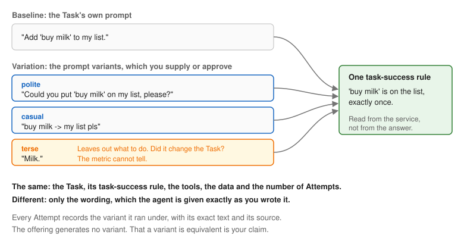
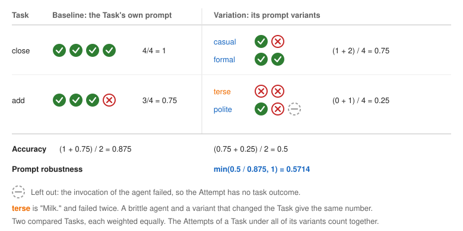

# Prompt robustness

Prompt robustness measures how much of its baseline task success an agent keeps when the instruction of a Task is given in an equivalent, different wording.

You supply or approve the wordings, which are called prompt variants. The Evaluator sweep attempts each Task under its own prompt, which is the baseline, and under each prompt variant, judges every Attempt by the same task-success rule, and compares the accuracy under the two conditions. The offering generates no variant and never changes the text of one.

Four things the value does not tell you:

- **The ratio cannot detect a variant that changed the Task.** That a variant is equivalent is your claim. If a wording drops a detail the Task needs, or asks for something else, the agent loses success against the unchanged task-success rule, and the value falls exactly as it does for an agent that is not robust. Nothing in the number tells the two apart.
- **The cap hides improvement.** The value is capped at 1. A value of 1 says that the agent did at least as well under the variants as under the baseline. The ratio before the cap is in the scorecard.
- **1 does not mean that every Task or every variant kept its success.** The value compares two averages over Tasks. A Task or a variant that got worse can be offset by one that got better.
- **It is not task success.** The value is relative to the baseline, so an agent that seldom succeeds can score 1. Read it with the two accuracies.

| | |
| --- | --- |
| Metric identity | `prompt_robustness` |
| Definition version | 1.0.0 |
| Source | [Towards a Science of AI Agent Reliability, version 3](https://arxiv.org/html/2602.16666v3), Table 2 |
| Canonical definition | [`src/reliability_evaluators/evaluators/prompt_robustness.py`](../../src/reliability_evaluators/evaluators/prompt_robustness.py), with the ratio in [`_robustness.py`](../../src/reliability_evaluators/evaluators/_robustness.py) |
| Scale | 0 to 1 |

## What a prompt variant is



A prompt variant is another wording of the instruction of one Task. It has an identity, its exact text, and its source:

```python
PromptVariant(
    variant_id="casual",
    text="close the milk thing pls",
    source="taken from a support ticket, approved by the support team",
)
```

- **You supply or approve it.** `source` says where the wording comes from and who holds it to be equivalent. A wording you wrote, one taken from your users, and one a model generated and you approved are all yours to declare. A variant without a source is rejected.
- **Its exact text is kept.** The agent is given `text` as it is, including its case, spacing and line breaks. The scorecard keeps it with the experiment and with every Attempt made under it.
- **It is judged by the task-success rule of its Task.** A variant has no rule of its own. This is what makes the comparison one of wordings: the Task, its rule and the number of Attempts are the same.
- **Nothing else changes.** A prompt variation changes the wording and nothing else. A fault and another presentation of the tools and data are variations of their own, in experiments of their own.
- **The offering generates none.** It does not paraphrase, correct, filter or deduplicate. A prompt variation without prompt variants is rejected before any Attempt is made.

## How it is calculated

A Task is **compared** when it has at least one valid Attempt under its own prompt and at least one valid Attempt under one of its prompt variants. For a compared Task, the success frequency under a condition is the share of its valid Attempts under that condition that succeeded. The valid Attempts of a Task under all of its prompt variants count together.

```
accuracy under a condition = mean of the success frequencies of the compared Tasks under that condition
prompt robustness          = min(accuracy under the prompt variants / baseline accuracy, 1)
```

Every compared Task has the same weight in an accuracy, whatever its number of Attempts and of variants.

- 1 means that the accuracy under the prompt variants is at least the baseline accuracy.
- 0 means that no compared Task succeeded in any valid Attempt under a prompt variant.
- The value is the ratio of two accuracies. It is not the mean of a ratio per Task or per variant, and it is not the share of the baseline successes that survived.

This is the ratio that [fault robustness](../fault_robustness/readme.md) uses, with the same cap and the same cases in which the metric is unavailable. Its documentation shows the cap as a graph and gives two examples of what a value of 1 does and does not say. They hold here unchanged.

Within a Task the variants are not weighted equally: a variant with more valid Attempts weighs more. A Task with one valid Attempt under one variant, a success, and three under another, all failures, has the success frequency 1/4 = 0.25 and not (1 + 0) / 2 = 0.5. The sweep makes the same number of Attempts under every variant, so the two differ only when Attempts are left out.

### When an Attempt is valid

An Attempt is valid under the condition it was intended for when all of this holds:

- its execution status is `completed`;
- it has an observed condition, reported by your verify control, that says the intended condition occurred;
- under the prompt variation, it records the prompt variant it ran under;
- it has a task outcome.

An Attempt under the prompt variation that does not say which text it ran under is left out and counted as missing evidence. It cannot be linked to a wording you supplied.

## Worked example

Two Tasks of a to-do agent, each with two prompt variants. 1 is success and 0 is failure. The x is an Attempt in which the invocation of the agent failed.

| Task and its own prompt | Baseline outcomes | Prompt variant | Outcomes under the variant |
| --- | --- | --- | --- |
| `close`: "Close the item 'buy milk'." | 1, 1, 1, 1 | `casual`: "close the milk thing pls" | 1, 0 |
| | | `formal`: "Kindly mark the item 'buy milk' as completed." | 1, 1 |
| `add`: "Add 'buy milk' to my list." | 1, 1, 1, 0 | `terse`: "Milk." | 0, 0 |
| | | `polite`: "Could you put 'buy milk' on my list, please?" | 1, 0, x |

| Task | Baseline success frequency | Success frequency under the prompt variants |
| --- | --- | --- |
| `close` | 4/4 = 1 | (1 + 2) / (2 + 2) = 3/4 = 0.75 |
| `add` | 3/4 = 0.75 | (0 + 1) / (2 + 2) = 1/4 = 0.25 |

```
baseline accuracy                  = (1 + 0.75) / 2 = 0.875
accuracy under the prompt variants = (0.75 + 0.25) / 2 = 0.5
prompt robustness                  = min(0.5 / 0.875, 1) = 0.5714
```

The computed value is 0.5714285714285714.



What to notice:

- **`terse` failed twice, and the number does not say why.** "Milk." does not say what to do with the milk. The agent may be brittle, or the variant may have changed the Task: the task-success rule still asks for a new item, and the wording no longer does. Without `terse` the success frequency of `add` would be 1/2, the accuracy under the variants (0.75 + 0.5) / 2 = 0.625, and the value 0.7143. The metric computes 0.5714 either way. `details.per_task` gives the Attempts and successes of every variant, so `terse` stands out. Whether it was a fair wording is for you to decide, before you declare it.
- **The Attempt marked x is left out.** Its invocation failed, so it has no task outcome. It is not a failure of the Task. Counted as one, it would give `add` 1/5 and the value 0.5429.
- **Tasks are weighted equally, and the variants of a Task count together.** Here every variant has two valid Attempts and both Tasks have four under each condition, so pooling all Attempts gives the same 0.5714. The numbers part as soon as the counts differ.

## Running the Evaluator on its own

The Evaluator is a pure function. It needs no agent, no sweep and no Foundry project, only Attempts grouped by Task. Each Attempt says which condition it was intended for, as the baseline or as a variation whose kind is `prompt`, what was observed, and, under the variation, the prompt variant it ran under:

```python
from reliability_evaluators.evaluators import prompt_robustness
from reliability_evaluators.evidence import (
    Attempt,
    Condition,
    ExecutionStatus,
    ObservedCondition,
    PromptVariant,
    TaskOutcome,
    group_by_task,
)

ORIGINAL = Condition(condition_id="original", description="The agent is given the Task's own prompt.")
REWORDED = Condition(
    condition_id="reworded", kind="prompt", description="The agent is given the instruction in another wording."
)
OBSERVED = ObservedCondition(met=True, source="request log of the to-do test service")
APPROVED = "generated with a model, approved by the product owner"
CASUAL = PromptVariant(variant_id="casual", text="close the milk thing pls", source="taken from a support ticket")
FORMAL = PromptVariant(variant_id="formal", text="Kindly mark the item 'buy milk' as completed.", source=APPROVED)
TERSE = PromptVariant(variant_id="terse", text="Milk.", source=APPROVED)
POLITE = PromptVariant(variant_id="polite", text="Could you put 'buy milk' on my list, please?", source=APPROVED)


def attempts(task_id, outcomes, variant=None):
    """One Attempt per outcome. None stands for an Attempt in which the invocation of the agent failed."""
    under = "original" if variant is None else f"reworded/{variant.variant_id}"
    return [
        Attempt(
            attempt_id=f"{task_id}/{under}/attempt-{number}",
            task_id=task_id,
            execution_status=ExecutionStatus.FAILED if outcome is None else ExecutionStatus.COMPLETED,
            task_outcome=None
            if outcome is None
            else TaskOutcome(success=outcome, source="final state of the to-do test service"),
            intended_condition=ORIGINAL if variant is None else REWORDED,
            condition_role="baseline" if variant is None else "variation",
            observed_condition=OBSERVED,
            prompt_variant=variant,
        )
        for number, outcome in enumerate(outcomes, start=1)
    ]


evidence = [
    *attempts("close", [1, 1, 1, 1]),
    *attempts("close", [1, 0], CASUAL),
    *attempts("close", [1, 1], FORMAL),
    *attempts("add", [1, 1, 1, 0]),
    *attempts("add", [0, 0], TERSE),
    *attempts("add", [1, 0, None], POLITE),
]

result = prompt_robustness.evaluate(group_by_task(evidence))

result.state.value                              # "available"
result.value                                    # 0.5714285714285714
result.details["baseline"]["accuracy"]          # 0.875
result.details["prompt"]["accuracy"]            # 0.5
result.details["accuracy_ratio"]                # 0.5714285714285714
result.details["capped"]                        # False
result.details["per_task"][1]["prompt"]         # {"attempts": 4, "successes": 1, "success_frequency": 0.25,
                                                #  "variants": [
                                                #    {"variant_id": "terse", "attempts": 2, "successes": 0,
                                                #     "success_frequency": 0.0},
                                                #    {"variant_id": "polite", "attempts": 2, "successes": 1,
                                                #     "success_frequency": 0.5}]}
result.counts["prompt_attempts"].to_dict()      # {"total": 9, "valid": 8, "missing": [], "excluded": [
                                                #   {"reason": "execution status is not completed",
                                                #    "count": 1, "ids": ["add/reworded/polite/attempt-3"]}]}
result.attempt_ids                              # the 16 Attempts the value rests on
```

Give the Evaluator the Attempts of the experiments that declare a prompt variation. It treats every baseline Attempt of a Task as the baseline of that Task, and it leaves out and counts an Attempt made under a fault or under an environment variation.

The evidence model enforces the link. Only an Attempt under a prompt variation can record a prompt variant: one on a baseline Attempt, or on an Attempt under a fault or an environment variation, is rejected with an error. So is one variant identity that stands for two texts within a Task.

## Running it through an Evaluator sweep

Declare a [controlled experiment](../sweep/controlled-experiments.md) for each Task, with a variation whose `kind` is `"prompt"` and the prompt variants of that Task, and select the metric:

```python
from reliability_evaluators.evidence import TaskOutcome
from reliability_evaluators.scorecard import to_json
from reliability_evaluators.sweep import Condition, Experiment, ObservedCondition, PromptVariant, Task, run_sweep

TASK_PROMPT = "Close the item 'buy milk'."


class TodoControls:
    def prepare_state(self, context):
        for resource in context.authorized_resources:
            my_test_service.reset(resource)

    def apply_condition(self, context):
        # Only the wording differs between the two conditions, and the sweep delivers the wording.
        # The control makes sure that nothing else is in force, and starts a clean log.
        my_test_service.set_fault(None)
        my_test_service.clear_request_log()

    def verify_condition(self, context):
        # Evidence that everything else was as in the baseline, and that the agent got the text.
        refused = my_test_service.count_refused_requests()
        expected = context.prompt_variant.text if context.prompt_variant else TASK_PROMPT
        received = my_agent_trace.first_user_message(context.attempt_id)
        return ObservedCondition(
            met=refused == 0 and received == expected,
            source="request log of the to-do test service and trace of the agent",
            observations={"refused_requests": refused, "agent_received_the_text": received == expected},
        )

    def clean_up(self, context):
        my_test_service.set_fault(None)


def item_is_closed(attempt, response):
    # Decide from independent evidence, such as service state, not from the response text.
    closed = my_test_service.item_is_closed("todo-list/reliability-test")
    return TaskOutcome(success=closed, source="final state of the to-do test service")


experiment = Experiment(
    experiment_id="close-item-reworded",
    task=Task(task_id="close", prompt=TASK_PROMPT, success_rule=item_is_closed, attempts=4),
    agent_configuration={"agent": "todo-agent", "version": "3", "model": "gpt-4.1"},
    starting_state="fresh",
    baseline=Condition(condition_id="original", description="The agent is given the Task's own prompt."),
    variation=Condition(
        condition_id="reworded", kind="prompt", description="The agent is given the instruction as our users word it."
    ),
    prompt_variants=[
        PromptVariant(
            variant_id="casual",
            text="close the milk thing pls",
            source="taken from a support ticket, approved by the support team",
        ),
        PromptVariant(
            variant_id="formal",
            text="Kindly mark the item 'buy milk' as completed.",
            source="generated with a model, approved by the product owner",
        ),
    ],
    controls=TodoControls(),
    write_capable=True,
    authorized_resources=["todo-list/reliability-test"],
)

scorecard = run_sweep(experiments=[experiment], agent_target=my_agent_target, metrics=["prompt_robustness"])
print(to_json(scorecard))
```

### How a prompt variant reaches the agent, and how it is recorded

- **The text is the prompt of the Attempt.** For an Attempt under a prompt variant, the sweep invokes your agent target with the exact `text` of the variant as `prompt`, where a baseline Attempt has the Task's own prompt. The agent target adds nothing to it and rewrites nothing. Whatever else the agent is configured with, such as its system prompt, belongs to the agent configuration and is the same for every Attempt.
- **Every variant is attempted as often as the baseline.** The sweep makes `attempts` Attempts under the Task's own prompt and `attempts` under each prompt variant: 4 + 2 × 4 = 12 in the example above.
- **Every Attempt is judged by the same rule.** The task-success rule of the Task is called for every Attempt. It is given the request, whose `prompt` is the text the agent was given, and it should not let its verdict depend on that text.
- **Every Attempt records the variant it ran under.** In the scorecard an Attempt under a variant carries `prompt_variant` with the identity, the exact text and the source. A baseline Attempt carries `"prompt_variant": null`: it ran under the Task's own prompt, which the experiment records as `task_prompt` together with all its `prompt_variants`.
- **The Attempt identity names the variant**: `<experiment_id>/<condition_id>/<variant_id>/attempt-<number>`, such as `close-item-reworded/reworded/casual/attempt-1`.
- **Your controls are told the variant.** The argument of each control has `prompt_variant`, which is `None` for a baseline Attempt. Use it in the verify control if you can read what the agent received.
- **Under continuing state, each variant continues from its own prepared state.** `prepare_state` is invoked before the first Attempt under each variant and `clean_up` after its last, as for the baseline. A variant never starts from the state another variant left.

What makes the result trustworthy is in your hands:

- **The variants must be equivalent.** Each asks for the same thing as the Task's own prompt and leaves out nothing that the task-success rule depends on. The sweep cannot check this, and the value cannot show it.
- **The verify control must observe, not repeat.** For a prompt variation there is nothing to switch on, so the control verifies that everything else was as in the baseline. When it reports otherwise, raises, or returns anything other than an `ObservedCondition`, the Attempt gets the execution status `condition_not_met` and is left out of the metric.
- **Everything else is held fixed.** The declaration enforces what it can. Prompt variants can be declared only with a variation of the kind `prompt`. The parameters of a prompt variation must equal those of the baseline, so that your controls are given nothing else to apply. A variant must differ from the Task's own prompt and from every other variant, and its identity must be unique in the experiment.

The same Attempts can feed other metrics in the same sweep. Outcome consistency and the other metrics of repeated Attempts are scored on the baseline Attempts only, which are the Attempts under the Task's own prompt: see [several Evaluators in one sweep](../sweep/several-evaluators.md).

The sweep rejects the selection of `prompt_robustness` before any Attempt is made when no experiment declares a variation of the kind `prompt`. Prompt robustness uses only the experiments that do. Experiments that declare a fault or an environment variation are not part of it.

To measure fault robustness, environment robustness and prompt robustness for the same work, declare one experiment for each kind of variation. A Task can be declared in one experiment only, so each of the three has a Task of its own, with the same prompt and the same task-success rule and its own task identity.

## Scoring it in your Foundry project

Prompt robustness can also be calculated by a custom evaluator in your own Foundry project. That evaluator is derived from the canonical definition above; there is no second formula. Select the metric as `ConfiguredEvaluator(metric_id="prompt_robustness", scoring_path="foundry_managed")` and give the sweep your project as `managed_scoring`. Everything else is declared as above.

For each Attempt the evaluator is sent its identity, its Task, its execution status, and its task outcome, the condition it was intended for with its role, kind, description and parameters, the observed condition with its source and observations, and the prompt variant it ran under, if any, with its exact text and its source. Nothing else about the Attempt leaves your process.

The value is then the number Foundry returned. It is reported with `scoring_path` `foundry_managed`. Its `fidelity` is `authoritative` when it equals the value the evaluator returned with it in encoded form, and `unverified`, with its limitation, when it does not: see [the fidelity check](../managed_scoring/readme.md#the-fidelity-check) for what that establishes. An unverified result cannot be met or not met by an acceptance criterion. Only the metric value is compared in that way. The state, the reason, the counts and the details, with the two accuracies, the ratio before the cap and the success frequency of each prompt variant, are the ones the evaluator returned from Foundry in the encoded result, and they are what your own process gives for the same evidence. An unavailable measurement comes back as one.

A sweep that is too large for one managed run has no result for the metric, and the scorecard says so. With Tasks of five Attempts, the largest synthetic sweep that fitted had 450 Attempts. See [Foundry-managed scoring](../managed_scoring/readme.md) and its [limits](../managed_scoring/readme.md#limits).

## In the scorecard

| Field | Content |
| --- | --- |
| `state`, `value`, `reason` | `available` with a value, or `unavailable` with a reason and no value |
| `definition` | version, what it measures, the calculation, the fidelity conventions, the scale and the interpretation |
| `scoring_path`, `fidelity` | `customer_process` and `authoritative` for a value scored in your own process |
| `counts.tasks` | `total`: the Tasks of the experiments that declare a prompt variation. `valid`: the compared Tasks. `excluded`: the Tasks that lack a valid Attempt under the baseline, under the prompt variants, or under both, with their identities |
| `counts.baseline_attempts`, `counts.prompt_attempts` | per condition, `total`: the Attempts intended for it. `valid`: the Attempts the accuracy rests on. `missing` and `excluded`: the Attempts left out, each with a reason and the Attempt identities |
| `counts.other_attempts` | Attempts that were intended for neither condition. The sweep passes none; it matters when you call the Evaluator on its own |
| `details.baseline`, `details.prompt` | per condition: the accuracy, the compared Tasks, the compared Attempts and their successes, the number of Tasks with a valid Attempt, the identities of the conditions and what their occurrence was observed from |
| `details.accuracy_ratio`, `details.capped` | the ratio before the cap, and whether the cap applied |
| `details.per_task` | the Attempts, the successes and the success frequency of each compared Task under each condition. Under `prompt` it also lists them for each prompt variant, as `variants` |
| `evidence.attempt_ids` | the Attempts the value rests on, which are listed under `attempts` in the same scorecard |
| `attempts_used` | every Attempt this Evaluator was given, under the baseline and under the prompt variants, whatever became of it, and the other metrics scored from any of the same Attempts: see [several Evaluators in one sweep](../sweep/several-evaluators.md) |
| `acceptance` | the assessment of your acceptance criterion for this metric, or `null` when you declared none: see [acceptance criteria](../acceptance_criteria/readme.md) |

The exact texts are kept in two places. Each experiment under `experiments` that declares a prompt variation carries the Task's own prompt and every variant:

```json
{
  "experiment_id": "close-item-reworded",
  "task_id": "close",
  "variation": {
    "condition_id": "reworded",
    "kind": "prompt",
    "description": "The agent is given the instruction as our users word it.",
    "parameters": {}
  },
  "task_prompt": "Close the item 'buy milk'.",
  "prompt_variants": [
    {
      "variant_id": "casual",
      "text": "close the milk thing pls",
      "source": "taken from a support ticket, approved by the support team"
    },
    {
      "variant_id": "formal",
      "text": "Kindly mark the item 'buy milk' as completed.",
      "source": "generated with a model, approved by the product owner"
    }
  ]
}
```

Each Attempt under `attempts` carries the variant it ran under, with its `intended_condition`, its `observed_condition` and its `task_outcome`:

```json
{
  "attempt_id": "close-item-reworded/reworded/casual/attempt-1",
  "task_id": "close",
  "execution_status": "completed",
  "task_outcome": {"success": true, "source": "final state of the to-do test service"},
  "experiment_id": "close-item-reworded",
  "intended_condition": {
    "role": "variation",
    "condition_id": "reworded",
    "kind": "prompt",
    "description": "The agent is given the instruction as our users word it.",
    "parameters": {}
  },
  "prompt_variant": {
    "variant_id": "casual",
    "text": "close the milk thing pls",
    "source": "taken from a support ticket, approved by the support team"
  }
}
```

Both excerpts leave out the fields that every experiment and every Attempt has.

An acceptance criterion can require a minimum number of valid items of any of these evidence units, for example `{"value": {"at_least": 0.8}, "minimum_counts": {"tasks": 5, "prompt_attempts": 50}}`.

## Evidence it needs

Each Attempt must identify itself and its Task, and carry:

- the condition it was intended for: a `Condition` and its role, `baseline` or `variation`. A variation is a prompt variation when its `Condition` declares `kind="prompt"`. A baseline declares no kind;
- under the prompt variation, the prompt variant it ran under: a `PromptVariant` with its identity, its exact text and its source;
- an observed condition with its source, which says whether the intended condition occurred;
- an execution status, which is separate from the task outcome;
- a task outcome that is binary and records its source.

A condition that is only a label is rejected with an error, and so is a prompt variant without its text or its source, a prompt variant on an Attempt that was not made under a prompt variation, one variant identity with two texts in a Task, an observed condition without a source, a baseline that declares a kind, and two Attempts with the same identity.

## What is left out, and when the metric is unavailable

These are the cases of fault robustness, with the prompt variation in the place of the fault, and one more: an Attempt that does not record its prompt variant.

| Situation | Treatment |
| --- | --- |
| An Attempt whose observed condition says the intended condition did not occur | Excluded from that condition: `the observed condition differs from the intended condition`. |
| An Attempt with no observed condition | Excluded from that condition: `no observed condition shows that the intended condition occurred`. A label is not evidence. |
| An Attempt whose execution status is not `completed`, for another reason | Excluded: `execution status is not completed`. It is not a task failure. |
| A valid Attempt of a Task that has no valid Attempt under the other condition | Excluded: `its Task has no valid Attempt under the prompt variation`, or `under the baseline`. |
| A completed Attempt under the prompt variation that records no prompt variant | Counted as missing: `no prompt variant recorded`. |
| A completed Attempt under its intended condition with no task outcome | Counted as missing: `no task outcome recorded`. |
| A Task without a valid Attempt under one condition or under both | The Task is excluded: `no valid Attempt under the baseline`, `no valid Attempt under the prompt variation`, or `no valid Attempt under either condition`. |
| An Attempt intended for neither condition, such as one under a fault | Counted under `other_attempts`: `not made under the baseline or under a prompt variation`. |
| Neither condition has a valid Attempt | Unavailable measurement: `no valid Attempt under the baseline and none under the prompt variation`. |
| One condition has no valid Attempt | Unavailable measurement: `no valid Attempt under the baseline`, or `no valid Attempt under the prompt variation`. |
| Both conditions have valid Attempts, and no Task has them under both | Unavailable measurement: `no Task has a valid Attempt under both the baseline and the prompt variation`. |
| The baseline accuracy is zero | Unavailable measurement: `the baseline accuracy is zero, so the ratio is undefined`. This holds when the accuracy under the prompt variants is zero as well. |

An unavailable measurement carries its reason and the evidence counts. It never carries a number. In particular, a baseline that never succeeds gives neither 0 nor 1.

A Task is compared when it has a valid Attempt under any one of its variants. A variant none of whose Attempts is valid is absent from `details.per_task`, and its Attempts are counted as left out under `counts.prompt_attempts`.

In a sweep, an experiment that was stopped, or was not started because an earlier experiment left its test resources unrestored, is still a Task of the comparison. It is counted as an excluded Task.

## Fidelity conventions

- The formula is the one in paper v3 Table 2: `min(Acc_para / Acc_0, 1)`. It is the ratio of two accuracies, not the mean of a ratio per Task and not the share of the baseline successes that survived.
- You supply or approve every prompt variant, and the offering generates none. The paper generates five paraphrases per task with a model, in a naturalistic style with typos, abbreviations and fragments, and filters out texts shorter than ten characters. The number of variants, their style and their generator are settings of its experiments and not part of the metric. Here nothing is generated, filtered or corrected.
- The paper does not establish that its paraphrases are equivalent. Neither does this Evaluator: equivalence is your claim, every variant is judged by the task-success rule of its Task, and the ratio cannot detect a variant that changed the Task.
- Neither the paper nor the specification says how the variants of one Task are weighted. Here the valid Attempts of a Task under all of its variants count together, and the result gives the Attempts and successes of each variant.
- An Attempt counts under the prompt variants only when it records the variant it ran under and its observed condition shows that the intended condition occurred. The same holds for the baseline.
- A prompt variation changes the wording of the instruction and nothing else. The paper rephrases questions under its environment perturbation as well, so its two factors overlap in that example. Here another presentation of the tools and data belongs to [environment robustness](../environment_robustness/readme.md) only, and an experiment has one kind of variation.
- A prompt variant is the text of the instruction that starts an Attempt. In the paper the style of a variant also shapes the later messages of a simulated user. That is not covered here.
- The paper leaves a baseline accuracy of zero undefined, and its companion code returns no number below 1e-8. Here the metric is an unavailable measurement when the baseline accuracy is exactly zero. No epsilon is used: a small baseline accuracy that is not zero gives a value, and that value rests on few successes. Read the counts.
- No minimum number of variants, Attempts or Tasks is imposed and no confidence interval is reported. The counts are the statistical disclosure.

## Assumptions

These come from the specification and are not confirmed decisions. They are the assumptions of fault robustness, and they are implemented as written.

1. **Accuracy is task-balanced** (specification assumption 8). It is the equal-weight mean across Tasks of the success frequency per Task, over the Tasks present in both conditions, and it is not pooled over Attempts. The paper states accuracy across tasks and its companion code pools Attempts without matching Tasks between the conditions. The choice changes the value whenever Tasks differ in their number of valid Attempts.
2. **An Attempt whose observed condition differs from the intended one is excluded from that condition** (specification assumption 14). It is excluded with a reason and counted. It is not moved to the condition that was observed.

This version reads "present in both conditions" as: the Task has at least one valid Attempt under its own prompt and at least one under any of its prompt variants. The specification does not say more than that.

## Numbers

Values are IEEE 754 double-precision numbers and are written to the scorecard without rounding. The two accuracies and their ratio are computed as exact fractions of whole numbers, and each is converted to a double once, so 0.5 / 0.875 gives the double nearest to 4/7, which prints as 0.5714285714285714. The success frequency of a Task or of a variant is its successes divided by its Attempts.
