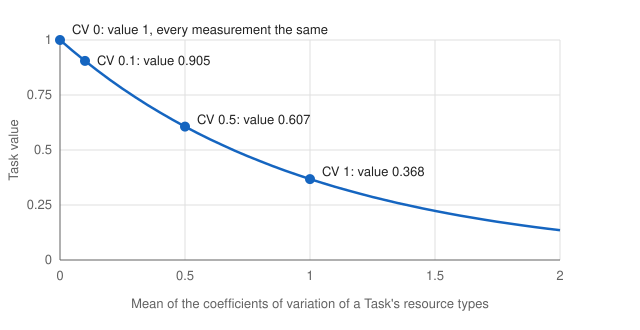
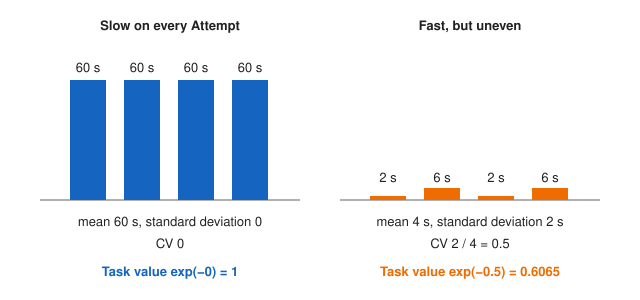
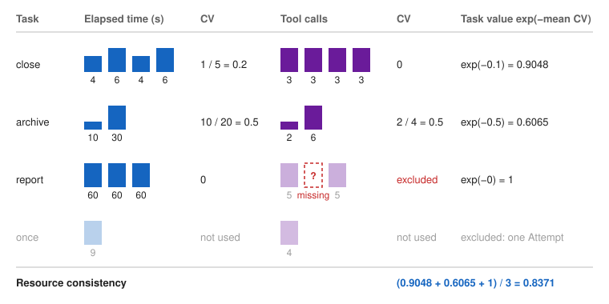

# Resource consistency

Resource consistency measures whether repeated Attempts at the same Task use similar resources: elapsed time, tool calls and, where it is reliably sourced, token usage.

It does not measure whether the agent uses few resources. **Stability is not efficiency**: an agent that takes 60 seconds on every Attempt scores 1, exactly like an agent that takes 2 seconds on every Attempt. Read this metric next to the measurements, never instead of them.

| | |
| --- | --- |
| Metric identity | `resource_consistency` |
| Definition version | 1.0.0 |
| Source | [Towards a Science of AI Agent Reliability, version 3](https://arxiv.org/html/2602.16666v3), Table 2 |
| Canonical definition | [`src/reliability_evaluators/evaluators/resource_consistency.py`](../../src/reliability_evaluators/evaluators/resource_consistency.py) |
| Scale | 0 to 1 |

## How it is calculated

For each Task and each resource type, take the measurements of the Task's Attempts and calculate the coefficient of variation (CV):

```
CV = population standard deviation / mean
```

The population standard deviation divides the sum of squared deviations by the number of Attempts `n`, not by `n - 1`. The CV has no unit, so seconds and tool calls can be averaged. The Task value is

```
exp(-mean of the CVs of the Task's resource types)
```

The metric is the mean of the Task values, with every eligible Task weighted equally. Measurements are never pooled across Tasks, because different Tasks are different workloads.



- 1 means that in every eligible Task, each resource type used measured the same in all Attempts.
- The value falls towards 0 as the measurements vary more between Attempts of the same Task. It never reaches 0.
- A mean CV of 0.5, where the measurements typically sit half their mean away from it, gives 0.607.

## Stability is not efficiency



The agent on the left is fifteen times slower on average and scores higher, because the metric only looks at how much the Attempts differ from each other. The mean of each resource type is reported per Task in `details.per_task`, so that the amount used can be read next to its stability.

## Worked example

Four Tasks, with the elapsed time and the tool-call count of each Attempt:

| Task | Elapsed time (seconds) | Tool calls |
| --- | --- | --- |
| `close` | 4, 6, 4, 6 | 3, 3, 3, 3 |
| `archive` | 10, 30 | 2, 6 |
| `report` | 60, 60, 60 | 5, missing, 5 |
| `once` | 9 | 4 |

`close`, elapsed time: the mean is (4 + 6 + 4 + 6) / 4 = 5. The deviations are −1, +1, −1, +1, so the population variance is (1 + 1 + 1 + 1) / 4 = 1 and the standard deviation is 1. CV = 1 / 5 = 0.2.

| Task | CV of elapsed time | CV of tool calls | Mean of the CVs | Task value |
| --- | --- | --- | --- | --- |
| `close` | 1 / 5 = 0.2 | 0 / 3 = 0 | (0.2 + 0) / 2 = 0.1 | exp(−0.1) = 0.9048 |
| `archive` | 10 / 20 = 0.5 | 2 / 4 = 0.5 | (0.5 + 0.5) / 2 = 0.5 | exp(−0.5) = 0.6065 |
| `report` | 0 / 60 = 0 | excluded: a measurement is missing | 0 | exp(−0) = 1 |
| `once` | not used | not used | | excluded: fewer than two Attempts whose execution completed |

Resource consistency = (0.9048 + 0.6065 + 1) / 3 = **0.8371** (0.8371226925828643 as computed).



Things to notice:

- `archive` shows the population standard deviation at work. Its two elapsed times are each 10 from the mean of 20, so the population standard deviation is 10 and the CV is 0.5. The sample standard deviation, which divides by `n - 1`, would be 14.14 and would give the Task 0.4931 instead of 0.6065.
- `report` has no tool-call count for its second Attempt. The count is not read as zero and the Attempt is not dropped. Tool calls are excluded for `report` only, and the Task is scored on elapsed time alone. Tool calls are still used for `close` and `archive`.
- `report` takes a minute on every Attempt and has the highest Task value.
- `once` is counted as an excluded Task with its reason. It is not scored as 1.

## Running the Evaluator on its own

The Evaluator is a pure function. It needs no agent, no sweep and no Foundry project, only Attempts grouped by Task:

```python
from reliability_evaluators.evaluators import resource_consistency
from reliability_evaluators.evidence import Attempt, ExecutionStatus, ResourceMeasurement, group_by_task

ELAPSED = "wall clock around the agent invocation, measured by my test harness"
TOOL_CALLS = "tool calls recorded by my agent service during the Attempt"

measured = {
    "close": [(4.0, 3), (6.0, 3), (4.0, 3), (6.0, 3)],
    "archive": [(10.0, 2), (30.0, 6)],
    "report": [(60.0, 5), (60.0, None), (60.0, 5)],
    "once": [(9.0, 4)],
}


def measurements(seconds, tool_calls):
    elapsed = ResourceMeasurement(resource_type="elapsed_time", value=seconds, unit="seconds", boundary=ELAPSED)
    if tool_calls is None:
        return [elapsed]  # a measurement that was not made is left off the Attempt
    return [
        elapsed,
        ResourceMeasurement(resource_type="tool_calls", value=tool_calls, unit="calls", boundary=TOOL_CALLS),
    ]


attempts = [
    Attempt(
        attempt_id=f"{task_id}/attempt-{number}",
        task_id=task_id,
        execution_status=ExecutionStatus.COMPLETED,
        resource_measurements=measurements(seconds, tool_calls),
    )
    for task_id, per_attempt in measured.items()
    for number, (seconds, tool_calls) in enumerate(per_attempt, start=1)
]

result = resource_consistency.evaluate(group_by_task(attempts))

result.state.value                 # "available"
result.value                       # 0.8371226925828643
result.counts["tasks"].to_dict()   # {"total": 4, "valid": 3, "missing": [], "excluded": [
                                   #   {"reason": "fewer than two Attempts whose execution completed",
                                   #    "count": 1, "ids": ["once"]}]}
result.details["resource_types"]   # per resource type: the Tasks it is used in, and excluded in with reasons
result.details["per_task"]         # per eligible Task: its resource types with mean and CV, and its value
result.details["excluded_tasks"]   # per excluded Task: its reason
result.attempt_ids                 # the nine Attempts the value rests on
```

## Running it through an Evaluator sweep

Select the metric in a sweep. The sweep times every invocation of the agent target and records what the agent target reports:

```python
from reliability_evaluators.agent_target import AgentResponse
from reliability_evaluators.evidence import ResourceMeasurement, TaskOutcome
from reliability_evaluators.scorecard import to_json
from reliability_evaluators.sweep import Task, run_sweep


class MyAgentTarget:
    def invoke(self, request):
        answer = my_agent.run(request.prompt)
        tool_calls = ResourceMeasurement(
            resource_type="tool_calls",
            value=len(answer.tool_calls),
            unit="calls",
            boundary="tool calls listed in the agent's response for this Attempt",
        )
        return AgentResponse(output=answer.text, resource_measurements=(tool_calls,))


def item_is_closed(attempt, response):
    closed = my_test_service.item_is_closed(attempt.attempt_id)
    return TaskOutcome(success=closed, source="final state of the to-do service")


scorecard = run_sweep(
    tasks=[Task(task_id="close", prompt="Close the item.", success_rule=item_is_closed, attempts=5)],
    agent_target=MyAgentTarget(),
    metrics=["resource_consistency"],
)
print(to_json(scorecard))
```

The metric's entry in the scorecard carries:

| Field | Content |
| --- | --- |
| `state`, `value`, `reason` | `available` with a value, or `unavailable` with a reason and no value |
| `execution_failure` | `null`, unless the metric has no result because the Attempts that supply its evidence were cut short; see [execution limits and partial scorecards](../sweep/execution-limits.md#metrics-in-a-partial-scorecard) |
| `cut_short` | The experiments, and the Tasks given without one, whose Attempts for this metric were cut short. Both lists are empty when none were |
| `definition` | version, what it measures, the calculation, the fidelity conventions, the scale and the interpretation |
| `scoring_path`, `fidelity` | `customer_process` and `authoritative` for a value scored in your own process |
| `counts` | Tasks and Attempts: total, valid (the denominator used), missing and excluded with reasons and identities |
| `details.resource_types` | **the resource types used and those excluded**: for each of the three resource types, the Tasks it is used in and the Tasks it is excluded in, grouped by reason |
| `details.per_task` | for each eligible Task: the number of Attempts, each resource type used with its unit, measurement boundary, mean and CV, each resource type excluded with its reason and the Attempts concerned, and the Task value |
| `details.excluded_tasks` | for each excluded Task: its reason and, where resource types were examined, why each was excluded |
| `evidence.attempt_ids` | the Attempts the value rests on, which are listed under `attempts` in the same scorecard |
| `attempts_used` | every Attempt this Evaluator was given, whatever became of it, and the other metrics scored from any of the same Attempts: see [several Evaluators in one sweep](../sweep/several-evaluators.md) |
| `acceptance` | the assessment of your acceptance criterion for this metric, or `null` when you declared none: see [acceptance criteria](../acceptance_criteria/readme.md) |

Each Attempt under `attempts` carries its `resource_measurements`, each with `resource_type`, `value`, `unit`, `boundary` and `reliably_sourced`.

The evidence units this metric counts are `tasks` and `attempts`, so an acceptance criterion can require a minimum number of eligible Tasks and of Attempts used, for example `{"value": {"at_least": 0.8}, "minimum_counts": {"tasks": 3, "attempts": 15}}`. A criterion on this metric accepts stable resource use, not low resource use.

## Evidence it needs

Each Attempt carries at most one resource measurement per resource type. A measurement has:

| Field | Content |
| --- | --- |
| `resource_type` | `elapsed_time`, `tool_calls` or `token_usage` |
| `value` | a finite number that is not negative. Tool calls and token usage are counts, so whole numbers (`int`). |
| `unit` | the unit of the value, such as `seconds` or `calls` |
| `boundary` | the measurement boundary: what the number covers, where the measurement starts and stops, and who measured it |
| `reliably_sourced` | whether the provider vouches that the number covers the whole Attempt. Defaults to `False` for token usage and `True` for the other resource types. |

Where the measurements come from in a sweep:

| Resource type | Source | Unit and measurement boundary |
| --- | --- | --- |
| Elapsed time | Measured by the sweep for every invocation that returns. | `seconds`; wall clock from just before the agent target is invoked until it returns. It includes the network and anything the agent target does, and excludes the task-success rule. |
| Elapsed time, alternative | An agent target that returns its own `elapsed_time` measurement is recorded instead of the sweep's. | As declared by the agent target. |
| Tool calls | Reported by the agent target in `AgentResponse.resource_measurements`. The sweep cannot see tool calls. | As declared by the agent target. |
| Token usage | Reported by the agent target, and used only when declared `reliably_sourced=True`. | As declared by the agent target. |

**Token usage is used as a resource only when reliably sourced.** Token usage reported by a platform can be incomplete, for example on error paths. Declare `reliably_sourced=True` only when the number is known to cover every model call of the Attempt. Otherwise token usage is excluded for the Task and disclosed.

Invalid evidence is rejected with an error and never calculated with: a value that is negative, not finite, not a number or too large to calculate with; a fractional count; a measurement without its unit or its measurement boundary; something that is not a resource type; and two measurements of the same resource type in one Attempt. A measurement that was not made is left off the Attempt. There is no way to record it as a value.

## What is left out, and when the metric is unavailable

A resource type is excluded for a Task, and named in the result with its reason, when:

| Situation | Reason reported |
| --- | --- |
| No Attempt of the Task has a measurement of it | `not measured in any Attempt of the Task` |
| Some Attempts of the Task have a measurement of it and others do not | `a measurement is missing in at least one Attempt of the Task`, with those Attempts |
| A measurement is not declared reliably sourced, which is the default for token usage | `not reliably sourced in every Attempt of the Task`, with those Attempts |
| The measurements are in more than one unit | `measured in more than one unit across the Attempts of the Task` |
| The measurements have more than one measurement boundary | `measured with more than one measurement boundary across the Attempts of the Task` |

The other resource types of that Task are still used, and the excluded resource type is still used for other Tasks.

| Situation | Treatment |
| --- | --- |
| An Attempt whose execution status is not `completed` | Excluded with the reason `execution status is not completed`, together with anything it measured. |
| A successful or a failed Attempt, or one with no task outcome | Included. The task outcome plays no part. |
| A resource measured as zero in every Attempt of a Task | Used, with a CV of 0. |
| A Task with fewer than two Attempts whose execution completed | The Task is excluded with a reason and its Attempts are counted as excluded. |
| A Task in which every resource type is excluded | The Task is excluded with the reason `no resource type has complete and comparable measurements`. |
| No Tasks | Unavailable measurement: `no Tasks in the evidence`. |
| No Task has two Attempts whose execution completed | Unavailable measurement: `no Task has at least two Attempts whose execution completed`. |
| No eligible Task otherwise | Unavailable measurement: `no resource type has complete and comparable measurements for any Task`. |

An unavailable measurement carries its reason, the evidence counts and the reasons each resource type was excluded. It never carries a number.

## Fidelity conventions

- The formula is the one in paper v3 Table 2: `CV = σ / μ` per resource type, combined as `exp(-mean of CVs)`.
- The table does not say which standard deviation. The **population** standard deviation of the observed Attempts is used. The companion code's sample standard deviation is not used. For the measurements 1 and 3 this definition gives a CV of 0.5 where the sample standard deviation gives 0.7071.
- Tasks are weighted equally. The table's expression leaves the aggregation across Tasks out; measurements are never pooled across Tasks.
- Successful and failed Attempts are both included. The paper's appendix describes conditioning on successful outcomes; Table 2 does not, and this definition does not.
- A resource measured as zero in every Attempt of a Task has zero variability: its CV is 0, although 0 / 0 is undefined. A missing measurement is never read as zero. The companion code's removal of measurements that are not positive is not used.
- The resource types are elapsed time, tool-call count and token usage, the last only when reliably sourced. A value is comparable only with values that used the same resource types, which is why the result names them.
- A negative or non-numeric measurement is rejected, so a mean of zero only arises when every measurement is zero.
- No minimum number of Attempts beyond two is imposed and no confidence interval is reported. The counts are the statistical disclosure.

## Assumptions

These come from the specification and are not confirmed decisions. They are implemented as written.

1. **A resource type with any missing measurement in a Task is excluded for that Task and disclosed, rather than making the Task undefined** (specification assumption 13). The Task is excluded only when no resource type is left for it.
2. **The metric is calculated over the eligible Tasks** (specification assumption 10). Excluded Tasks are counted with their reasons. The metric is unavailable only when no Task is eligible.

These were made while implementing the definition. The specification does not state them. They are not confirmed decisions either.

3. **A Task needs at least two Attempts whose execution completed.** With one Attempt every CV is 0, so the Task would score 1 with no repeated Attempt behind it. The specification states this for outcome consistency only (its assumption 11).
4. **An Attempt whose execution status is not `completed` is excluded**, with whatever it measured. A failed execution does not measure a whole Attempt, and it would otherwise make every resource type incomplete for its Task.
5. **A resource type measured in more than one unit, or with more than one measurement boundary, in a Task is excluded for that Task**, because its measurements are not comparable.
6. **"Reliably sourced" is a declaration by whoever provides the measurement.** The Evaluator cannot check it. It applies to every resource type, and only token usage is unreliable unless declared otherwise.
7. **The resource types are a closed set of three.** A different set changes what the metric means, so another resource type is rejected and not silently averaged in.

## Numbers

Values are IEEE 754 double-precision numbers and are written to the scorecard without rounding. Measurements are recorded as given. Before the CV is calculated, the measurements of one resource type in one Task are divided by a power of two, which is exact and keeps very large and very small measurements in range. The mean, the square root, the exponential and the mean across Tasks are each correct to within rounding, so a value can differ from the exact result in the last digit.
