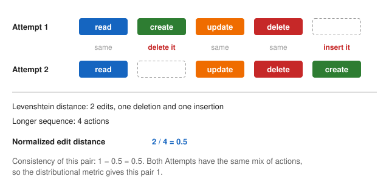
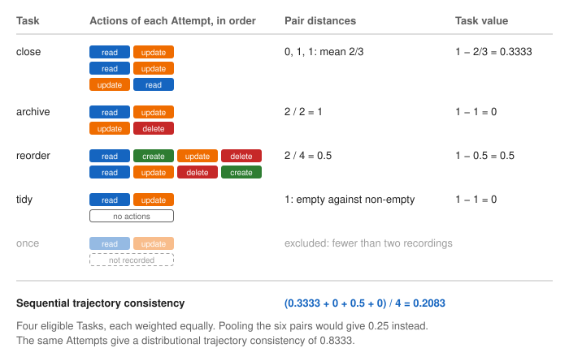

# Sequential trajectory consistency

Sequential trajectory consistency measures whether repeated Attempts at the same Task take their actions in the same order.

**A high value shows neither correctness nor compliance.** An agent that takes the same wrong or forbidden actions in the same order on every Attempt scores 1. A low value is not a failure either: different orders can be equally valid. Whether the Attempts use the same mix of actions, whatever the order, is what [distributional trajectory consistency](../distributional_trajectory_consistency/readme.md) measures.

| | |
| --- | --- |
| Metric identity | `sequential_trajectory_consistency` |
| Definition version | 1.0.0 |
| Source | [Towards a Science of AI Agent Reliability, version 3](https://arxiv.org/html/2602.16666v3), Table 2 |
| Canonical definition | [`src/reliability_evaluators/evaluators/sequential_trajectory_consistency.py`](../../src/reliability_evaluators/evaluators/sequential_trajectory_consistency.py) |
| Scale | 0 to 1 |

## What you declare

Two things, and neither has a default:

- **The evidence source**: where the actions of an Attempt are recorded from, for example the agent's native tool calls or the effects observed on the service side. The two can differ for the same Attempts, and then the metric differs too. In a prototype run, the same five Attempts gave 1 from service-side effects and 0.9333 from native tool calls, where one Attempt showed an extra leading read. This offering does not choose for you.
- **The action-type mapping**: the action type of each tool name. Tool names with the same action type are the same action.

Both are written into the scorecard next to the value.

## How it is calculated

1. The actions of each Attempt are mapped to action types, keeping their order.
2. For every pair of Attempts at a Task, the Levenshtein distance between their two action-type sequences is divided by the length of the longer sequence. The Levenshtein distance is the smallest number of insertions, deletions and substitutions that turns one sequence into the other.
3. The Task value is one minus the mean of that normalized distance over all pairs of its Attempts.
4. The metric is the mean of the Task values, with every eligible Task weighted equally.



The pair in the picture: `read, create, update, delete` becomes `read, update, delete, create` by deleting `create` and inserting it at the end, which is 2 edits. One edit cannot do it: the sequences are equally long, so a single edit would be a substitution, and three positions differ. The normalized distance is 2 / 4 = 0.5 and the pair has a consistency of 1 − 0.5 = 0.5.

Two conventions cover the empty sequence:

- Two Attempts that are both confirmed to have taken no action are identical: distance 0.
- An Attempt that took no action and one that took any action are maximally different: distance 1.

## Worked example

Five Tasks. The declared mapping is `get_item` and `list_items` → `read`, `create_item` → `create`, `update_item` → `update`, `delete_item` → `delete`.

| Task | Attempt | Recorded tool calls | Action-type sequence |
| --- | --- | --- | --- |
| `close` | 1 | `get_item`, `update_item` | read, update |
| | 2 | `list_items`, `update_item` | read, update |
| | 3 | `update_item`, `get_item` | update, read |
| `archive` | 1 | `get_item`, `update_item` | read, update |
| | 2 | `update_item`, `delete_item` | update, delete |
| `reorder` | 1 | `get_item`, `create_item`, `update_item`, `delete_item` | read, create, update, delete |
| | 2 | `get_item`, `update_item`, `delete_item`, `create_item` | read, update, delete, create |
| `tidy` | 1 | `get_item`, `update_item` | read, update |
| | 2 | recorded, no tool calls | empty: a confirmed empty sequence |
| `once` | 1 | `get_item`, `update_item` | read, update |
| | 2 | not recorded | unknown |

| Task | Pairs | Normalized distance of each pair | Mean | Task value |
| --- | --- | --- | --- | --- |
| `close` | 3 | (1,2): 0 / 2 = 0; (1,3): 2 / 2 = 1; (2,3): 2 / 2 = 1 | 2/3 | 1 − 2/3 = 1/3 |
| `archive` | 1 | 2 / 2 = 1 | 1 | 1 − 1 = 0 |
| `reorder` | 1 | 2 / 4 = 0.5 (worked out above) | 0.5 | 1 − 0.5 = 0.5 |
| `tidy` | 1 | 1: empty against non-empty | 1 | 1 − 1 = 0 |
| `once` | not used | | | excluded: fewer than two Attempts with a usable action recording |

Sequential trajectory consistency = (1/3 + 0 + 0.5 + 0) / 4 = 5/24 = **0.2083** (0.20833333333333334 as computed), over 6 pairs of Attempts in 4 eligible Tasks.



Things to notice:

- In `close`, `read, update` against `update, read` has distance 2: no position matches, and no single insertion or deletion lines the two up. The same Attempts have identical action mixes, so the distributional metric gives `close` 1. The two metrics answer different questions: the same Attempts give a distributional trajectory consistency of 0.8333.
- `get_item` and `list_items` count as the same action because the mapping declares both as `read`.
- `tidy` is scored. Its second Attempt is known to have taken no action, which is maximally different from an Attempt that acted. The distributional metric cannot score this Task and excludes it.
- `once` is excluded: its second Attempt has no recording at all. A missing recording is not a confirmed empty sequence, so it is not compared as one.
- Tasks are weighted equally whatever their number of pairs. Pooling the six pairs would give 1 − 4.5 / 6 = 0.25, which is a different number and not this metric.

## Running the Evaluator on its own

The Evaluator is a pure function. It needs no agent, no sweep and no Foundry project, only Attempts grouped by Task and your declaration:

```python
from reliability_evaluators.evaluators import sequential_trajectory_consistency
from reliability_evaluators.evidence import (
    ActionEvent,
    ActionEvidence,
    ActionTypeMapping,
    Attempt,
    ExecutionStatus,
    group_by_task,
)

SOURCE = "native tool calls"
NOT_RECORDED = None
tool_calls = {
    "close": [["get_item", "update_item"], ["list_items", "update_item"], ["update_item", "get_item"]],
    "archive": [["get_item", "update_item"], ["update_item", "delete_item"]],
    "reorder": [
        ["get_item", "create_item", "update_item", "delete_item"],
        ["get_item", "update_item", "delete_item", "create_item"],
    ],
    "tidy": [["get_item", "update_item"], []],
    "once": [["get_item", "update_item"], NOT_RECORDED],
}
attempts = [
    Attempt(
        attempt_id=f"{task_id}/attempt-{number}",
        task_id=task_id,
        execution_status=ExecutionStatus.COMPLETED,
        action_evidence=None
        if tool_names is NOT_RECORDED
        else ActionEvidence(source=SOURCE, events=[ActionEvent(tool_name=name) for name in tool_names]),
    )
    for task_id, recordings in tool_calls.items()
    for number, tool_names in enumerate(recordings, start=1)
]
action_types = ActionTypeMapping(
    evidence_source=SOURCE,
    action_types={
        "get_item": "read",
        "list_items": "read",
        "create_item": "create",
        "update_item": "update",
        "delete_item": "delete",
    },
)

result = sequential_trajectory_consistency.evaluate(group_by_task(attempts), action_types)

result.state.value                        # "available"
result.value                              # 0.20833333333333334
result.counts["attempt_pairs"].valid      # 6
result.counts["tasks"].to_dict()          # total 5, valid 4, and the excluded Task with its reason
result.details["per_task"]                # Attempts, pairs, mean distance and value of each eligible Task
result.details["evidence_source"]         # "native tool calls"
result.details["action_type_mapping"]     # the mapping as declared
result.attempt_ids                        # the nine Attempts the value rests on
```

An `ActionEvent` also carries the `arguments`, `result` and `error` of the call. They are kept as evidence and are not compared by this metric.

## Running it through an Evaluator sweep

Declare where action evidence is recorded from and the action type of each tool name, and select the metric. The sweep makes the Attempts, records the actions of each one, scores in your own process, and returns the reliability scorecard:

```python
from reliability_evaluators.evidence import ActionEvent, TaskOutcome
from reliability_evaluators.scorecard import to_json
from reliability_evaluators.sweep import ActionEvidenceDeclaration, Task, run_sweep


def item_is_closed(attempt, response):
    closed = my_test_service.item_is_closed(attempt.attempt_id)
    return TaskOutcome(success=closed, source="final state of the to-do service")


def calls_seen_by_the_service(attempt, response):
    # Return None when nothing was recorded. An empty list confirms the Attempt took no action.
    calls = my_test_service.calls_during(attempt.attempt_id)
    if calls is None:
        return None
    return [
        ActionEvent(tool_name=call.operation, arguments=call.arguments, result=call.result, error=call.error)
        for call in calls
    ]


scorecard = run_sweep(
    tasks=[Task(task_id="close", prompt="Close the item.", success_rule=item_is_closed, attempts=5)],
    agent_target=my_agent_target,
    metrics=["distributional_trajectory_consistency", "sequential_trajectory_consistency"],
    action_evidence=ActionEvidenceDeclaration(
        evidence_source="service-side effects",
        record=calls_seen_by_the_service,
        action_types={"get_item": "read", "list_items": "read", "update_item": "update"},
    ),
)
print(to_json(scorecard))
```

Both trajectory metrics are scored from the same Attempts: selecting both does not make the agent run twice. Selecting either without `action_evidence` is rejected before any Attempt is made.

The metric's entry in the scorecard carries:

| Field | Content |
| --- | --- |
| `state`, `value`, `reason` | `available` with a value, or `unavailable` with a reason and no value |
| `definition` | version, what it measures, the calculation, the fidelity conventions, the scale and the interpretation |
| `scoring_path`, `fidelity` | `customer_process` and `authoritative` for a value scored in your own process |
| `counts.tasks`, `counts.attempts` | total, valid (the denominator used), missing and excluded with reasons and identities |
| `counts.attempt_pairs` | the number of pairs of Attempts that were compared |
| `details.evidence_source` | the evidence source you declared |
| `details.action_type_mapping` | the action type of each tool name, as you declared it |
| `details.tool_names_without_action_type` | tool names that were recorded but are not in the mapping |
| `details.per_task` | Attempts, pairs, mean normalized edit distance and Task value of each eligible Task |
| `evidence.attempt_ids` | the Attempts the value rests on, which are listed under `attempts` in the same scorecard |
| `attempts_used` | every Attempt this Evaluator was given, whatever became of it, and the other metrics scored from any of the same Attempts: see [several Evaluators in one sweep](../sweep/several-evaluators.md) |

Each Attempt under `attempts` carries its `action_evidence`: the source and the events in order, each with tool name, arguments, result and error. It is `null` for an Attempt that was not recorded.

## Evidence it needs

Each Attempt must identify itself and its Task, and carry:

- an execution status;
- ordered action evidence: its source, and one event per action with the tool name, the arguments, the result and the error, in the order the actions were taken.

A task outcome is not needed. Successful and failed Attempts are both included.

An event without a tool name is rejected with an error. So are arguments or a result that are not JSON-compatible data, a recording without a source, and two Attempts with the same identity.

## What is left out, and when the metric is unavailable

| Situation | Treatment |
| --- | --- |
| An Attempt whose execution status is not `completed` | Excluded with the reason `execution status is not completed`. Its trajectory was cut short by something other than the agent. |
| An Attempt with no action recording | Counted as missing with the reason `no action recording`. It is not compared as an empty sequence. |
| An Attempt recorded from another source than the declared one | Excluded with the reason `its action recording is not from the declared evidence source`. Sources are never mixed. |
| An Attempt with a tool name that has no declared action type | Excluded with the reason `an action event has no declared action type`. The tool names are listed in `details.tool_names_without_action_type`. |
| A Task with fewer than two usable Attempts | The Task is excluded with the reason `fewer than two Attempts with a usable action recording`. |
| No Tasks | Unavailable measurement: `no Tasks in the evidence`. |
| No eligible Task | Unavailable measurement: `no Task has at least two Attempts with a usable action recording`. |

An unavailable measurement carries its reason and the evidence counts. It never carries a number.

Leaving an Attempt out can raise the value: an Attempt that called an undeclared tool is unlike the others by construction. Read the excluded counts, and complete the mapping when `tool_names_without_action_type` is not empty.

## Fidelity conventions

- The formula is the one in paper v3 Table 2: Levenshtein distance divided by the longer sequence length, over all pairs of Attempts.
- **Successful and failed Attempts are both included.** The companion code compares successful, non-empty trajectories only.
- **Two confirmed empty sequences are identical.** The paper's formula is 0 / 0 for them.
- **An empty and a non-empty sequence are maximally different.** This follows from the formula: every action of the non-empty sequence is an insertion.
- No minimum number of Attempts beyond two is imposed and no confidence interval is reported. The counts are the statistical disclosure.

## Assumptions

These come from the specification and are not confirmed decisions. They are implemented as written.

1. **The customer declares the action-type mapping and the evidence source, and no default is chosen** (specification open point 22). Which trace is authoritative for the trajectory metrics was not settled.
2. **The metric is calculated over the eligible Tasks** (specification assumption 10). Excluded Tasks are counted with their reasons. The metric is unavailable only when no Task is eligible.
3. **When attempt counts differ between Tasks, the pair mean is taken per Task and Tasks are then weighted equally.** The paper's formula assumes the same number of Attempts for every Task.

Three more conventions fill gaps that neither the paper nor the specification covers. They are choices of this definition, version 1.0.0:

4. An Attempt whose execution did not complete is excluded, as it is for outcome consistency.
5. An Attempt with a tool name that has no declared action type is excluded with a reason, by analogy with the unmapped severity label of specification assumption 16. It is not an error.
6. The action type is decided by the tool name alone. To tell apart calls to one tool by their arguments, record them under different tool names. Actions that ran in parallel must be recorded in one declared order.

## Numbers

Values are IEEE 754 double-precision numbers and are written to the scorecard without rounding. Distances and means are calculated in exact rational arithmetic and converted to a double once, so 5/24 gives exactly the double nearest to it, 0.20833333333333334.
