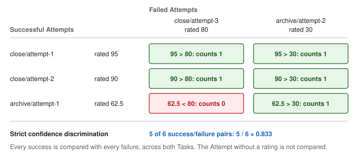
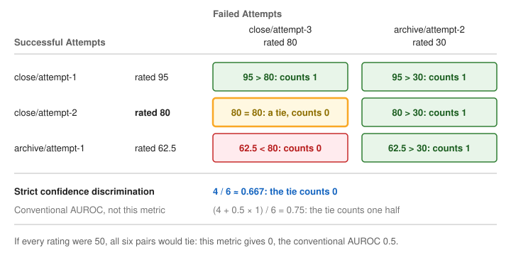

# Strict confidence discrimination

Strict confidence discrimination measures whether successful Attempts received a higher confidence rating than failed ones. After each Attempt the agent is asked how likely it thinks the task succeeded. Every successful Attempt is then compared with every failed Attempt. The metric is the share of those comparisons in which the success was rated strictly higher, so higher is better.

**It is strict: a tie scores zero. This is not the conventional AUROC**, which gives a tie half credit. An agent that gives every Attempt the same rating scores 0 here and 0.5 with the conventional AUROC. Do not compare the value with an AUROC from another tool. The number of tied pairs is always reported, so you can see how much of the difference is due to ties.

| | |
| --- | --- |
| Metric identity | `strict_confidence_discrimination` |
| Definition version | 2.0.0 |
| Source | [Towards a Science of AI Agent Reliability, version 3](https://arxiv.org/html/2602.16666v3), Table 2 |
| Canonical definition | [`src/reliability_evaluators/evaluators/strict_confidence_discrimination.py`](../../src/reliability_evaluators/evaluators/strict_confidence_discrimination.py) |
| Scale | 0 to 1 |

Strict confidence discrimination is one of three predictability metrics that are calculated from the same confidence/outcome pairs and reported as three separate results. The other two are [calibration](../calibration/readme.md) and the [Brier-based score](../brier_based_score/readme.md). They are not combined.

## How it is calculated

Each Attempt can give one confidence/outcome pair:

- `c` is the confidence: the agent's rating from 0 to 100, divided by 100.
- `y` is the task outcome: 1 for a success, 0 for a failure.

A success/failure pair is one successful Attempt together with one failed Attempt. Every success is compared with every failure, so there are `successes × failures` such pairs. The metric is

```
number of success/failure pairs in which c of the success > c of the failure
----------------------------------------------------------------------------
                           successes × failures
```

- 1 means every successful Attempt was rated strictly higher than every failed Attempt.
- 0 means no successful Attempt was rated strictly higher than any failed Attempt. That includes every rating being equal.
- A pair in which the two ratings are equal counts as zero, the same as a pair in which the failure was rated higher.
- Ratings are compared exactly as the agent wrote them. Nothing is rounded: 70.01 is higher than 70.

All valid pairs are pooled into one set. A success at one Task is compared with a failure at another, and Tasks are not averaged first.

## Worked example

Two Tasks with three Attempts each. `close` and `archive` are the Task identities. These are the same six Attempts as in the worked examples of the [Brier-based score](../brier_based_score/readme.md#worked-example) and of [calibration](../calibration/readme.md#worked-example):

| Attempt | Agent's answer | c | Task outcome |
| --- | --- | --- | --- |
| `close/attempt-1` | `95` | 0.95 | success |
| `close/attempt-2` | `90` | 0.9 | success |
| `close/attempt-3` | `80` | 0.8 | failure |
| `archive/attempt-1` | `62.5` | 0.625 | success |
| `archive/attempt-2` | `30` | 0.3 | failure |
| `archive/attempt-3` | `Fairly sure.` | none | success: not used, no rating |

Three successes and two failures have a rating, which gives 3 × 2 = 6 success/failure pairs:

| | Failure `close/attempt-3`, rated 80 | Failure `archive/attempt-2`, rated 30 |
| --- | --- | --- |
| Success `close/attempt-1`, rated 95 | 95 > 80: counts 1 | 95 > 30: counts 1 |
| Success `close/attempt-2`, rated 90 | 90 > 80: counts 1 | 90 > 30: counts 1 |
| Success `archive/attempt-1`, rated 62.5 | 62.5 < 80: counts 0 | 62.5 > 30: counts 1 |

Strict confidence discrimination = 5 / 6 = **0.8333…**



Three things to notice:

- The success of `archive` rated 62.5 is compared with the failure of `close` rated 80, and loses. The pairs are pooled across Tasks. Comparing within each Task only would give 1 for both Tasks.
- `archive/attempt-3` has no rating. It is counted as a missing pair with its reason, and it is not compared with anything. It is not treated as a confidence of 0.
- The same six Attempts give a Brier-based score of 0.823375 and a calibration of 0.675. The three metrics answer three different questions and are reported separately.

## What a tie does

Suppose `close/attempt-2` had answered `80` instead of `90`. It is still a success, and it now has the same rating as the failure `close/attempt-3`:

| | Failure `close/attempt-3`, rated 80 | Failure `archive/attempt-2`, rated 30 |
| --- | --- | --- |
| Success `close/attempt-1`, rated 95 | 95 > 80: counts 1 | 95 > 30: counts 1 |
| Success `close/attempt-2`, rated 80 | 80 = 80: a tie, counts 0 | 80 > 30: counts 1 |
| Success `archive/attempt-1`, rated 62.5 | 62.5 < 80: counts 0 | 62.5 > 30: counts 1 |

Strict confidence discrimination = 4 / 6 = **0.6666…**



The conventional AUROC gives the tied pair half credit and would be (4 + 0.5 × 1) / 6 = 0.75. The two differ whenever a success/failure pair is tied:

| Ratings | Success rated higher | Tied | Failure rated higher | This metric | Conventional AUROC |
| --- | --- | --- | --- | --- | --- |
| The worked example | 5 | 0 | 1 | 5 / 6 = 0.8333… | 5 / 6 = 0.8333… |
| `80` instead of `90` | 4 | 1 | 1 | 4 / 6 = 0.6666… | 4.5 / 6 = 0.75 |
| Every rating `50` | 0 | 6 | 0 | 0 | 3 / 6 = 0.5 |

- This metric is never above the conventional AUROC. It is below it by half the share of tied pairs.
- Coarse ratings cause ties. An agent that answers only in multiples of 10, or that answers 100 nearly every time, gets nothing for a success/failure pair with equal ratings. Read the value next to the tied-pair count.
- A value of 0 can mean that every pair is tied or that every failure was rated higher than every success. The counts tell the two apart.
- The conventional AUROC is not reported as a value. The three counts are, and `(success_rated_higher + 0.5 × tied) / total` gives it if you need to compare with another tool.

## Running the Evaluator on its own

The Evaluator is a pure function. It needs no agent, no sweep and no Foundry project, only Attempts grouped by Task:

```python
from reliability_evaluators.evaluators import strict_confidence_discrimination
from reliability_evaluators.evidence import (
    Attempt,
    ExecutionStatus,
    TaskOutcome,
    group_by_task,
    read_confidence_response,
)

answers = {
    "close/attempt-1": ("95", True),
    "close/attempt-2": ("90", True),
    "close/attempt-3": ("80", False),
    "archive/attempt-1": ("62.5", True),
    "archive/attempt-2": ("30", False),
    "archive/attempt-3": ("Fairly sure.", True),
}
attempts = [
    Attempt(
        attempt_id=attempt_id,
        task_id=attempt_id.split("/")[0],
        execution_status=ExecutionStatus.COMPLETED,
        task_outcome=TaskOutcome(success=success, source="final state of the to-do service"),
        confidence=read_confidence_response(answer),
    )
    for attempt_id, (answer, success) in answers.items()
]

result = strict_confidence_discrimination.evaluate(group_by_task(attempts))

result.state.value                         # "available"
result.value                               # 0.8333333333333334
result.counts["confidence_outcome_pairs"].to_dict()
                                           # {"total": 6, "valid": 5, "missing": [
                                           #   {"reason": "confidence rating unavailable: no number in the confidence response",
                                           #    "count": 1, "ids": ["archive/attempt-3"]}], "excluded": []}
result.counts["success_failure_pairs"].to_dict()
                                           # {"total": 6, "valid": 6, "missing": [], "excluded": []}
result.details["successes"]                # 3
result.details["failures"]                 # 2
result.details["success_failure_pairs"]    # {"total": 6, "success_rated_higher": 5, "tied": 0,
                                           #  "failure_rated_higher": 1}
result.details["pairs"]                    # the five raw confidence/outcome pairs
result.attempt_ids                         # the five Attempts the value rests on
```

`read_confidence_response` turns the agent's answer into a `ConfidenceRating` or a `ConfidenceUnavailable` with a reason. The rating is text, exactly as the agent wrote it.

## Running it through an Evaluator sweep

Select the metric by its identity. Each Task needs a `shareable_success_rule`, and the agent target has to declare that it can ask an isolated follow-up. Both are described, with a complete example, in the [Brier-based score documentation](../brier_based_score/readme.md#running-it-through-an-evaluator-sweep):

```python
scorecard = run_sweep(
    tasks=tasks,
    agent_target=MyAgentTarget(),
    metrics=["calibration", "strict_confidence_discrimination", "brier_based_score"],
)
```

The agent is asked for its confidence once per Attempt, however many of the three metrics are selected. Each selected metric is a separate entry in the scorecard with its own value, state, counts and details. Selecting `strict_confidence_discrimination` alone is enough to have the agent asked.

How the rating is collected, what the agent is shown, how its answer is read and when a rating is unavailable is the same for all three metrics: see [how the confidence rating is collected](../brier_based_score/readme.md#how-the-confidence-rating-is-collected).

## Scoring it in your Foundry project

Strict confidence discrimination can also be calculated by a custom evaluator in your own Foundry project. That evaluator is derived from the canonical definition above; there is no second formula. Select the metric as `ConfiguredEvaluator(metric_id="strict_confidence_discrimination", scoring_path="foundry_managed")` and give the sweep your project as `managed_scoring`. Everything else is declared as above.

For each Attempt the evaluator is sent its identity, its Task, its execution status, and its task outcome and its confidence evidence: the rating as the agent wrote it with the whole response it was read from, or the reason there is no rating. With it goes the condition the Attempt was intended for, with its role, description and parameters, when the Attempt was made in an experiment: the evaluator leaves out an Attempt made under a variation, as the canonical definition does. The rating travels as text, so the evaluator calculates from the same exact fractions as your own process. Nothing else about the Attempt leaves your process.

The value is then the number Foundry returned. It is reported with `scoring_path` `foundry_managed`. Its `fidelity` is `authoritative` when it equals the value the evaluator returned with it in encoded form, and `unverified`, with its limitation, when it does not: see [the fidelity check](../managed_scoring/readme.md#the-fidelity-check) for what that establishes. An unverified result cannot be met or not met by an acceptance criterion. Only the metric value is compared in that way. The state, the reason, the counts and the details, with the counts of success/failure pairs and every raw pair, are the ones the evaluator returned from Foundry in the encoded result, and they are what your own process gives for the same evidence. An unavailable measurement comes back as one.

A sweep that is too large for one managed run has no result for the metric, and the scorecard says so. With Tasks of five Attempts, the largest synthetic sweep that fitted had 235 Attempts. See [Foundry-managed scoring](../managed_scoring/readme.md) and its [limits](../managed_scoring/readme.md#limits).

## In the scorecard

The metric's own entry carries:

| Field | Content |
| --- | --- |
| `name` | `Strict confidence discrimination` |
| `state`, `value`, `reason` | `available` with a value, or `unavailable` with a reason and no value |
| `execution_failure` | `null`, unless the metric has no result because the Attempts that supply its evidence were cut short; see [execution limits and partial scorecards](../sweep/execution-limits.md#metrics-in-a-partial-scorecard) |
| `cut_short` | The experiments, and the Tasks given without one, whose Attempts for this metric were cut short. Both lists are empty when none were |
| `definition` | version, what it measures, the calculation, the fidelity conventions, the scale and the interpretation. The fidelity conventions state that the value is not the conventional AUROC. |
| `scoring_path`, `fidelity` | `customer_process` and `authoritative` for a value scored in your own process |
| `counts.confidence_outcome_pairs` | `total` is the number of Attempts, `valid` the number of valid confidence/outcome pairs, and `missing` and `excluded` the Attempts that gave no pair, by reason and by Attempt identity |
| `counts.success_failure_pairs` | `total` and `valid` are both `successes × failures`: every success/failure pair is compared. `valid` is the denominator of the value. |
| `details.successes`, `details.failures` | how many of the valid confidence/outcome pairs are successes and how many are failures |
| `details.success_failure_pairs.total` | `successes × failures` |
| `details.success_failure_pairs.success_rated_higher` | the pairs that count: the numerator of the value |
| `details.success_failure_pairs.tied` | the pairs with equal ratings, which count as zero |
| `details.success_failure_pairs.failure_rated_higher` | the pairs in which the failure was rated higher |
| `details.pairs` | every valid confidence/outcome pair: Attempt and Task identity, `rating` as written, `confidence`, and `task_outcome` with its `source` |
| `evidence.attempt_ids` | the Attempts the value rests on. Empty when the metric is unavailable. |
| `attempts_used` | every Attempt this Evaluator was given, whatever became of it, and the other metrics scored from any of the same Attempts: see [several Evaluators in one sweep](../sweep/several-evaluators.md) |
| `acceptance` | the assessment of your acceptance criterion for this metric, or `null` when you declared none: see [acceptance criteria](../acceptance_criteria/readme.md). A criterion can require a number of success/failure pairs with `{"minimum_counts": {"success_failure_pairs": 20}}`. |

The individual success/failure pairs are not listed, because their number grows with the product of the two classes. Every one of them can be rebuilt from `details.pairs`.

## Evidence it needs

The same as the Brier-based score. Each Attempt must identify itself and its Task, and carry:

- an execution status;
- a task outcome that is binary and records its source;
- confidence evidence: a `ConfidenceRating` or a `ConfidenceUnavailable` with its reason.

The rating and the task outcome are both part of the one Attempt record, so they are paired by Attempt identity and never by their position in a list.

## What is left out, and when the metric is unavailable

Every Attempt is counted once in `counts.confidence_outcome_pairs`, under the first of these that applies:

| Situation | Treatment |
| --- | --- |
| An Attempt made under the variation of an experiment | Excluded with the reason `made under a variation, and this metric is calculated from Attempts under the baseline`. The metric describes the agent under the baseline. A sweep gives the Evaluator baseline Attempts only. Called on its own with the Attempts of a whole experiment, the Evaluator leaves the others out itself and counts them. An Attempt that records no condition was made without an experiment and is used. |
| The execution status is not `completed` | Excluded: `execution status is not completed`. It is not a task failure. |
| A completed Attempt with no task outcome | Missing: `no task outcome recorded`. |
| A completed Attempt with an outcome and no confidence evidence | Missing: `no confidence rating recorded`. |
| A completed Attempt with an outcome and an unavailable rating | Missing: `confidence rating unavailable:` followed by the reason. |

The metric is an unavailable measurement in three situations:

| Situation | Reason |
| --- | --- |
| No valid pair at all, including no Attempts | `no valid confidence/outcome pair` |
| The valid pairs hold no success | `no success among the valid confidence/outcome pairs, so there is no success/failure pair` |
| The valid pairs hold no failure | `no failure among the valid confidence/outcome pairs, so there is no success/failure pair` |

With only one class of outcome there is nothing to compare: the denominator is zero. The result is unavailable. It is not 0, not 0.5 and not 1. An unavailable measurement carries its reason, the counts and the raw pairs, and never a number.

A failed Attempt without a rating does not count as a failure here: only valid pairs are compared. Calibration and the Brier-based score need only one valid pair, so they can have a value from the same Attempts while this metric is unavailable.

## Fidelity conventions

- The formula is the one in paper v3 Table 2: the number of success/failure pairs with the confidence of the success strictly greater than that of the failure, divided by the number of successes times the number of failures.
- The paper's text calls this equivalent to AUROC, and its companion code calculates the conventional AUROC, in which a tied pair counts one half. The two are not equivalent when ratings tie. The Table 2 formula is used and half credit is deliberately not given. That is why the metric is named strict confidence discrimination and not AUROC.
- The number of tied success/failure pairs is always reported, with the number in which the success was rated higher and the number in which the failure was rated higher.
- Only complete pairs are used. The metric is unavailable when the valid pairs hold no success or no failure.
- The rating comes from a separate confidence-only request after the Attempt. The paper's heuristic fallback for an answer that cannot be parsed is deliberately not adopted.
- The confidence is the agent's own estimate after the fact. It is not an independently verified probability. A high value shows that the ratings order successes above failures. It does not show that the ratings are calibrated: 51 on every success and 49 on every failure scores 1.
- No minimum number of pairs is imposed and no confidence interval is reported. The counts are the statistical disclosure. Repeated Attempts at one Task are not independent observations.
- This metric is separate from calibration and from the Brier-based score. It is not combined with them.
- **The metric is calculated from the Attempts made under the baseline.** An Attempt that records a variation as its condition is excluded with a reason and counted, whoever calls the Evaluator, so a value is the same in a sweep and on the evidence of a whole experiment. Version 1.0.0 scored every Attempt it was given and left the selection to the sweep.

## Assumptions

This comes from the specification and is not a confirmed decision. It is implemented as written.

1. **All valid confidence/outcome pairs are pooled across Tasks and Attempts as the observation set** (specification assumption 9). The paper is ambiguous between tasks and observations. Every Attempt given to the Evaluator is a candidate, whatever its Task, so a success at an easy Task is compared with a failure at a hard one.

## What is not verified

Strict confidence discrimination is calculated from the same confidence ratings as the Brier-based score, so the same limits apply: see [on Foundry agents](../brier_based_score/readme.md#on-foundry-agents) there. Where a rating cannot be collected in an isolated follow-up, as for a Foundry hosted agent, the three predictability metrics are unavailable by decision, through either entry point.

## Numbers

- The rating is kept as the text the agent wrote. It is never turned into a number and back for display.
- Ratings are compared exactly. Each rating is read as a fraction, so two ratings tie only when they are the same number: `87.50` ties with `87.5`, and `70.00000000000000000001` is higher than `70` although both are written as the same `confidence` in the scorecard.
- The counts are whole numbers. The value is `success_rated_higher / total`, converted to an IEEE 754 double-precision number once, and written to the scorecard without rounding.
- `confidence` is the double nearest to the rating divided by 100.
